# hu-agent 企业级 Agent 平台设计文档

- 文档版本：v1.2（后端技术栈调整：Python 3.14 + FastAPI + uv）
- 日期：2025-10-13
- 状态：接口与数据模型已冻结；技术栈调整见 11 章 D2 / D15
- 读者：产品、客户端、服务端、前端、测试、运维

---

## 1. 文档说明

### 1.1 目的与范围

本文档描述 hu-agent 企业级 Agent 平台的完整设计，覆盖三个交付物：

| 交付物 | 说明 |
| --- | --- |
| hu-agent-app | 桌面客户端（Windows / macOS），本地 Agent 运行时 |
| hu-agent-management | 服务端，负责账号、组织、权限、市场、云同步、统计 |
| hu-agent-management-ui | 服务端管理台（浏览器 Web 应用） |

本阶段只做设计，不包含实现排期细节。文档中的接口、字段、表结构是后续开发的契约基线，评审通过后冻结 v1.0。

### 1.2 设计原则

1. **本地优先（Local-first）**：Agent 循环、会话、工作空间、密钥都在本地；服务端不可用时，核心能力（对话、工具、本地模型）不受影响。
2. **一切皆文件**：工作空间内的会话、Skill、MCP 配置、日志均为可读可同步的普通文件；服务端同理只存"包"与"元数据"。
3. **最小权限、显式授权**：默认只允许访问工作空间内文件；越界操作必须用户确认，且全程可审计。
4. **企业可治理**：组织 / 团队两级资源归属，所有资源变更走审批 + 审计；用量数据可聚合、可导出。
5. **协议先行**：客户端与服务端之间只有 HTTP(S) API 和对象存储预签名 URL 两种交互，全部版本化、幂等、可重试。

### 1.3 术语表

| 术语 | 含义 |
| --- | --- |
| Workspace（工作空间） | 用户选择的本地目录，是 Agent 的文件沙箱与资产容器 |
| Session（会话） | 一次完整对话，持久化为工作空间内的 `.jsonl` 文件 |
| Skill（技能） | 一组提示词 + 可执行脚本/参考文档的目录包，通过 `SKILL.md` 描述 |
| MCP | Model Context Protocol，外部工具服务协议 |
| 组织 / 团队 | 服务端的资源归属与权限层级，团队属于组织 |
| 快照（Snapshot） | 工作空间整体 zip 的一个不可变版本 |
| 上报事件（Usage Event） | 一次模型调用的 token 用量记录 |

### 1.4 需求覆盖对照

| 需求 | 章节 |
| --- | --- |
| Core Agent Loop | 5.2 |
| 默认工具（read/edit/write/bash/powershell/ask_guide） | 5.4 |
| Skill 市场（浏览/下载/更新/启停） | 5.7、6.4 |
| MCP 市场（浏览/启停） | 5.8、6.5 |
| Workspace（沙箱、会话 JSONL、上传、越界授权、云同步） | 5.5、5.6、5.11、6.6 |
| 本地 Skill / MCP 配置（Global + Workspace） | 5.7、5.8 |
| 本地大模型配置（Global） | 5.9 |
| 用量上报（模型名 + token 明细） | 5.10、6.7 |
| 权限设计（系统/组织/团队管理员） | 6.2、6.3 |
| Skill / MCP 上架审批 | 6.4、6.5 |
| 统计管理（启用情况、token 维度） | 6.7、7.4 |
| 注册 / 登录 / SSO | 6.2、6.12、8.1 |

---

## 2. 产品概览

### 2.1 三个组件的关系

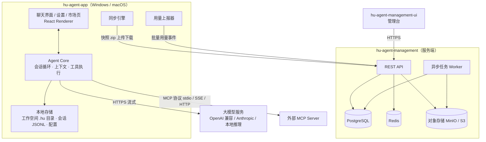

### 2.2 角色与权限总览

| 角色 | 产生方式 | 核心权限 |
| --- | --- | --- |
| 系统管理员 | 系统初始化时内置 | 审批组织创建、管理全局设置、查看全局统计与审计 |
| 组织管理员 | 组织创建审批通过后自动成为 | 审批团队创建、邀请成员入组织、管理组织统计与设置 |
| 团队管理员 | 团队创建审批通过后自动成为 | 审批 Skill/MCP 上架、上下架/删除资源、邀请组织成员入团队 |
| 成员 | 被邀请加入组织/团队 | 使用团队资源、提交 Skill/MCP、查看个人统计 |

权限细节见 6.2。角色是"组织/团队成员关系上的属性"，不是全局身份：同一用户可以在 A 组织是管理员、在 B 组织是成员。

### 2.3 范围边界（本期非目标）

- 不做对话内容的服务端存储与检索（服务端只存快照 zip，且不解析内容）。
- 不做 Web 版 Agent（只做桌面客户端）。
- 不做模型网关/统一代理（客户端直连模型服务商），但服务端保留价格表用于统计口径。
- 不做 SSO / LDAP / SCIM（接口预留，见 11 章 D10）。
- 不做实时协作编辑（云同步是快照级，不是文件级双向实时同步）。

---

## 3. 总体架构

### 3.1 组件职责划分

| 组件 | 职责 | 明确不做 |
| --- | --- | --- |
| hu-agent-app | Agent 循环、工具执行、权限审批、工作空间沙箱、本地配置、市场客户端、同步与上报 | 不做用户数据的权威存储（本地为主） |
| hu-agent-management | 账号与组织体系、RBAC、审批流、市场元数据与包存储、快照存储、用量聚合、审计 | 不下发模型密钥、不代理模型流量、不解析快照内容 |
| hu-agent-management-ui | 管理台页面 | 无独立逻辑，全部通过 API |
| 对象存储 | Skill/MCP 包、工作空间快照的不可变对象 | 不参与权限逻辑 |

### 3.2 技术选型

> 选型原则：团队熟悉度优先；能用成熟单体就不拆微服务；v1 只引入必要的中间件。已确认的决策标注 ✅（完整决策记录见 11 章）。

| 层 | 选型 | 理由 |
| --- | --- | --- |
| 客户端外壳 | ✅ Electron + TypeScript | Agent 循环、工具执行、MCP 均在 Node 生态；迭代速度优先（D1） |
| 客户端 UI | React + TypeScript + Vite + Tailwind + shadcn/ui | 桌面端更现代；管理台单独用 Ant Design |
| 服务端 | ✅ Python 3.14 + FastAPI + uv | 单人开发主力语言（D2）；Pydantic v2 校验 + 自动 OpenAPI 3.1；uv 统一依赖与 Python 运行时 |
| 管理台 | React + TypeScript + Vite + Ant Design | 企业后台生态最全（表格、审批组件） |
| 数据库 | PostgreSQL 18 | JSONB、分区表、`citext`、内置 `uuidv7()`；主键统一 UUIDv7（时间有序） |
| 数据访问 | SQLAlchemy 2.0（Core/ORM）+ psycopg 3（async） | 复杂统计查询直接手写 SQL；参数绑定防注入；psycopg 对新 Python 版本跟进更快 |
| Schema 变更 | 编号 DDL 脚本手工维护（不引入 Flyway/Liquibase） | 见 6.8.3：只追加、人工/流水线执行、附回滚脚本 |
| 缓存 / 锁 | Redis 7（缓存 / 限流）+ PostgreSQL advisory lock | v1 不引入消息队列；worker 定时任务用 advisory lock + `job_runs` 防重 |
| 对象存储 | MinIO（S3 兼容） | 本地部署友好，API 通用；社区版已不发布 Docker 镜像，本地由 `docker/minio/Dockerfile` 源码构建 |
| 接口规范 | REST + OpenAPI 3.1（FastAPI 自动生成） | 管理台与客户端用 openapi-typescript 生成调用代码 |
| 鉴权 | PyJWT（access 15min）+ 旋转 refresh token（30d）+ 设备绑定；SSO 用 authlib | 桌面端需要长期登录 |
| 密码哈希 | argon2id（argon2-cffi） | 现代默认 |
| 部署 | Docker Compose（开发/小规模）→ K8s（生产） | 先简单后扩展 |

> 依赖兼容性提示：Python 3.14 较新，`pydantic-core`、`psycopg[binary]`、`SQLAlchemy`、`boto3` 等需在 M0 用 `uv sync` 实测并锁定（提交 `uv.lock`）；若个别库暂无 3.14 wheel，优先换库或改用纯 Python 驱动，不降级 Python 版本。

### 3.3 部署形态

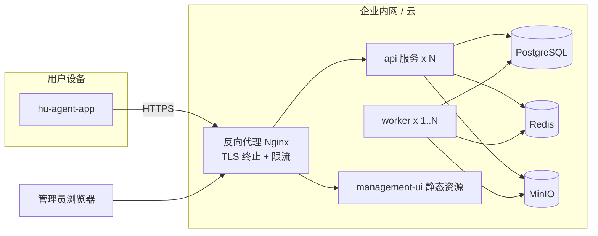

部署要求：

- 生产环境必须 TLS（客户端校验证书，可配置企业自签 CA）。
- `api` 无状态可水平扩展；`worker` 至少 1 副本，任务幂等。
- 备份：PostgreSQL PITR/WAL 归档 + MinIO 版本化；RPO ≤ 1h、RTO ≤ 4h（可调）。
- 健康检查 `/healthz`（存活）、`/readyz`（依赖就绪）。

---

## 4. 核心数据流

### 4.1 设备登录与绑定

1. 客户端首次启动生成设备指纹（`device_id` = 随机 UUID，持久化在全局配置）。
2. 用户输入服务器地址，选择登录方式：本地账号密码 → `POST /auth/login`；或企业 SSO（OIDC，见 6.12，系统浏览器 + 回环回调）。
3. 服务端校验后签发：access token（15min，含 `user_id`、`device_id`、`roles_version`）+ refresh token（30d，DB 存哈希，旋转式）。
4. 客户端把 refresh token 写入系统钥匙串（Windows Credential Manager / macOS Keychain），access token 仅存内存。
5. 每次 `POST /auth/refresh` 旧 refresh token 立即失效（检测重放：若旧 token 被再次使用，撤销该设备全部会话）。
6. 本地模式：不登录也能用 Agent（仅本地模型、本地工具）；市场、同步、上报功能提示登录。

实现要点（阶段 4-01/4-03/4-05）：

- 注册/登录/刷新/登出/设备接口均已实现；登录时 upsert `devices` 并写 `auth.login` 审计，注册写 `auth.register`。
- 登录失败不区分"用户不存在/密码错误"，避免账号枚举；密码校验失败计入限流，成功登录清零计数。
- 刷新旋转：新令牌入同一 `family_id`，旧行标记 `revoked_at` 与 `replaced_by_id`；已撤销令牌再次使用视为重放，撤销该设备全部会话并写站内通知。
- 吊销设备 = 撤销该设备未撤销的刷新令牌 + 删除 `devices` 行（重新登录会重建）；吊销当前设备后客户端本地会话同步清理。
- 客户端 access token 仅存内存，refresh 存 safeStorage 密钥库；401 自动刷新一次后重试，失败即登出。

### 4.2 一次 Agent 会话（概览）

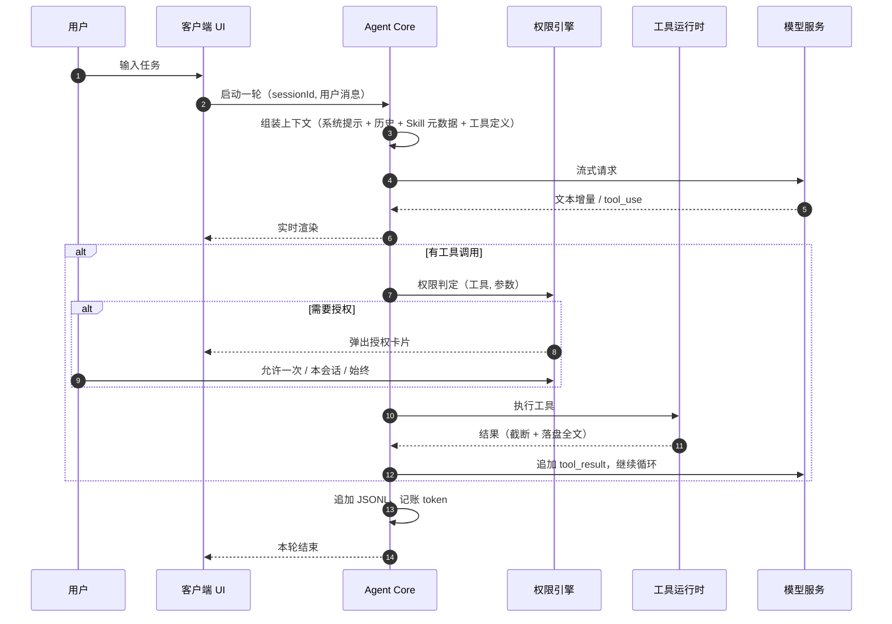

### 4.3 Skill 从上传到客户端启用

1. 团队成员在管理台上传 Skill 包 → 服务端创建 `skill_version`（`pending`）+ 审批单。
2. 团队管理员审批通过 → 版本 `published`，成为团队资源；对象存储中的包不可变。
3. 成员客户端在市场页看到该 Skill → 下载 zip → 校验 sha256 → 解压到本地 Skill 目录 → 记录 `installed.json`。
4. 用户启用（Global 或当前 Workspace）→ 写入对应配置文件；下次会话加载 `SKILL.md` 元数据进入系统提示。
5. 客户端把启用状态上报服务端（见 4.5），供团队统计。

### 4.4 工作空间云同步（概览）

采用**快照链**模型：服务端保存不可变版本 `v1, v2, ...`，客户端维护 `baseVersion`，上传时做乐观锁校验，冲突必须人工选择，绝不静默覆盖。详见 5.11 与 6.6。

### 4.5 用量上报

- 客户端每次模型调用结束后本地记账，事件写入本地队列（崩溃不丢）。
- 网络可用时批量上报（≤ 100 条/批），`event_id` 幂等；失败指数退避重试，保留 7 天。
- 服务端落 `usage_events`（按月分区），worker 每小时聚合到 `usage_daily`，统计接口查聚合表。
- 上报内容仅含：模型/供应商、token 明细、耗时、状态、身份与归属维度；**不含提示词、回复内容、文件路径**。

## 5. hu-agent-app 详细设计

### 5.0 引擎架构（pi 为核）—— 现状与归属

> 本节记录 v1.x 引擎重构后的客户端**实际架构**。5.2 / 5.3 / 5.4 / 5.8 / 5.9 描述的是重构前的自研实现，
> 已被 pi 原生实现取代，保留作为历史对照。决策、迁移过程与删除清单见 `docs/adr/0006-pi-agent-engine.md`。

**归属划分（谁拥有什么）**

| 领域 | 归属 | 客户端实现位置 |
| --- | --- | --- |
| 模型与 provider | pi（`pi-ai` + `models.json`） | `model/pi_config.ts`（配置层）、`model/pi_runtime.ts`（运行时装配：`models` 集合注册与 `refresh()`） |
| 回合生命周期 | pi（`pi-durable` 的 Harness/Conversation） | `agent/durable_loop.ts`（回合回环：submit + 订阅 viewState）、`agent/durable_runner.ts`（每回合装配） |
| 消息与会话 | pi（`pi-durable` 的 entries + storage） | `session/durable.ts`（会话服务 + 视图索引）、`session/durable_view.ts`（durable → 界面视图的纯映射） |
| 工具 | pi（`AgentTool` + typebox） | `tools/native/*`（read/write/edit/bash/powershell/ask_guide）、`agent/pi_governance.ts`（默认工具集） |
| MCP | pi（`pi-mcp`：stdio + streamable HTTP） | `mcp/manager.ts` |
| 权限 / 审批 / 审计 | **我们**（挂 pi-durable 扩展的 `beforeTool` / `afterTool` 钩子） | `agent/durable_loop.ts` 的 Guard 扩展（纯钩子，不包装工具） |
| 用量与成本 | pi 产出用量 → 我们落账与上报 | `usage/ledger.ts`、`cloud/reporter.ts` |
| IPC 事件 | **我们**，定义为 pi 事件在边界的机械投影 | `agent/durable_projection.ts`（`pi.live` → `AgentEvent`） |

**关键不变式（换引擎不降级）**

1. 权限判定与审批仍在 `PermissionEngine`（含敏感路径、保护文件硬规则）；被拒绝的调用在 `beforeTool`
   被 block，**工具体不执行**，拒绝状态由投影层补 `denied`（UI 能与执行报错区分）；
2. 超长输出落 artifact 并在 `afterTool` 中段截断（避免撑爆上下文）；
3. 用量三写（会话 + ledger + telemetry）由回合回环完成，数据源是 pi 的 `pi.usage`；
4. 停止原因（`done` / `cancelled` / `error`）由回环决定并通过 `turn.end` 事件发出；旧 `max_steps`
   已随自研循环删除（轮次管理归 pi-durable），IPC 契约中的该值待 R6 清理时移除。

**工作空间隔离与密钥**

- 每个工作空间的权限引擎、会话与产物存储、技能段、遥测出口在**每回合装配**（`ipc.ts` 的 `context.createRunner`）；
- 个人模式：密钥在本机密钥库（safeStorage），**按请求注入 pi**，不写进 `models.json`；
- 企业模式：密钥只在服务端，由 `streamProxy` 供流（客户端不持有）。

### 5.1 进程与模块架构

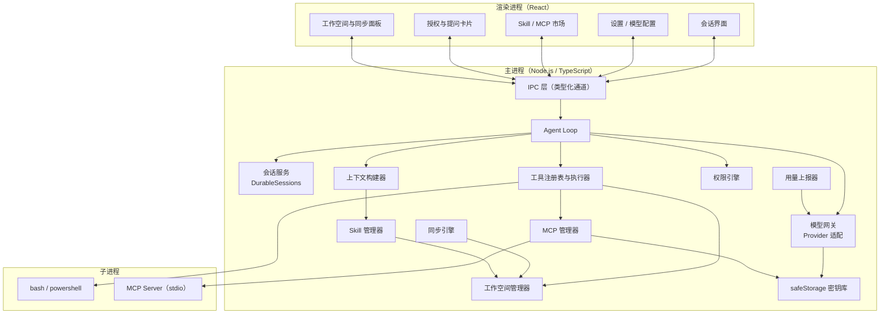

安全基线：

- `contextIsolation: true`、`nodeIntegration: false`、`sandbox: true`（渲染进程）；主进程只暴露白名单 IPC 通道。
- 渲染进程严格 CSP；Markdown 渲染统一走消毒器（禁止内联脚本/事件属性）；外链必须经用户确认后 `shell.openExternal`。
- 不提供应用菜单栏（Electron 默认 File/Edit/View/... 菜单已移除，macOS 保留系统最小菜单），操作全部在应用界面内完成。
- 所有文件、命令操作只发生在主进程，渲染进程永远拿不到绝对路径以外的能力（路径也必须经工作空间管理器解析）。

信息架构（阶段 3 调整，已完成；D16 强制登录）：

- 顶部 Tab 栏为页面导航：「对话」为默认页，每个配置类页面独立一个 tab（模型配置 / Skill 配置 / MCP 配置 / 工作空间 / 权限与审计 / 关于）；
- 对话页始终挂载（切换 tab 仅隐藏），避免流式输出与待授权卡片因卸载丢失；
- 左下角仅保留「个人中心」入口（账号/登入状态、本地用量、工作空间摘要）；
- 启动门禁：未登录（或服务端拒绝会话）时渲染全屏登录/注册页，不渲染主界面；令牌被服务端撤销/账号被禁用时，主进程广播 `cloud:session-lost`，界面立即退回门禁。

### 5.2 Core Agent Loop

> ⚠️ 本节描述重构前的自研循环，已被 `pi-durable` 的回合回环取代：实现见 `agent/durable_loop.ts`
> 与 `agent/durable_runner.ts`，归属与不变式见 5.0 与 `docs/adr/0006-pi-agent-engine.md`。

#### 5.2.1 消息与事件模型

```ts
// 模型上下文中的消息
type Role = 'system' | 'user' | 'assistant' | 'tool'
type Part =
  | { type: 'text'; text: string }
  | { type: 'reasoning'; text: string; signature?: string }    // 思考内容：仅存档展示，不回传模型（Anthropic 工具续轮除外）
  | { type: 'image'; mimeType: string; dataRef: string }   // 本地文件引用，不内联进 JSONL
  | { type: 'tool_use'; id: string; name: string; input: unknown }
  | { type: 'tool_result'; toolUseId: string; status: 'ok' | 'error' | 'denied' | 'timeout'; output: string }
type Message = { id: string; role: Role; parts: Part[]; createdAt: string }

// 主进程 -> UI 的事件（IPC 单向流）
type AgentEvent =
  | { type: 'turn.start'; turnId: string }
  | { type: 'assistant.delta'; turnId: string; text: string }
  | { type: 'reasoning.delta'; turnId: string; text: string }
  | { type: 'tool.call'; turnId: string; call: { id: string; name: string; input: unknown } }
  | { type: 'tool.approval_required'; turnId: string; request: ApprovalRequest }
  | { type: 'tool.result'; turnId: string; result: Part & { type: 'tool_result' } }
  | { type: 'ask_guide'; turnId: string; question: GuideQuestion }
  | { type: 'usage.update'; turnId: string; usage: TokenUsage }
  | { type: 'turn.end'; turnId: string; stopReason: 'done' | 'cancelled' | 'max_steps' | 'error' }
  | { type: 'session.compacted'; summaryLine: number }
```

#### 5.2.2 循环流程

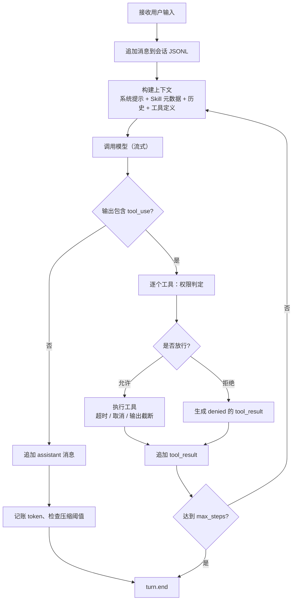

关键参数（可在设置中调整，企业策略可覆盖）：

| 参数 | 默认值 | 说明 |
| --- | --- | --- |
| `max_steps` | 50 | 单轮最多工具调用轮次，防止死循环 |
| `tool_timeout` | 120s | 单工具超时；bash 可在调用参数内指定上限 600s |
| `tool_output_limit` | 30,000 字符 | 超出则头尾截断，全文落盘为 artifact |
| `compact_threshold` | 上下文窗口 70% | 触发历史压缩 |
| `keep_recent_messages` | 8 | 压缩时保留最近 8 条消息原文（其余生成摘要） |
| `retry` | 模型请求 3 次指数退避 | 仅对网络/限流错误；工具调用不自动重试写操作 |

#### 5.2.3 上下文构建与压缩

上下文顺序（从高到低优先级）：

1. 系统提示：角色、行为约束、工具使用规范、工作空间信息、权限策略摘要。
2. Skill 目录：每个已启用 Skill 的 `name / description / when_to_use / 路径`（**渐进披露**：只注入元数据，模型需要时自行 `read_file` 读取 `SKILL.md` 全文）。
3. 历史压缩摘要（若有）+ 最近 8 条消息原文。
4. 当前用户消息。

压缩策略：

- 触发时（估算 token 超过上下文窗口 70%），用"快速模型"对较早消息生成结构化摘要（目标 ≤ 800 token），摘要写入 JSONL 的 `summary` 行（含 `fromLine/toLine` 行号区间）。
- 保留：系统提示、Skill 元数据、最近 8 条消息原文、所有未完成的 `tool_use / tool_result` 对；摘要以 system 消息注入上下文（`loadContextMessages`）。
- 摘要链：多次压缩产生多条 `summary` 行，构建上下文时只应用最新一条（其引用终点之后的消息仍以原文保留）。
- 压缩前先确保会话已落盘；压缩失败降级为截断最早消息，不阻塞会话。
- 工具结果全文 artifact 不进入上下文，模型可按 artifact 路径重读。

#### 5.2.4 错误处理与中断

| 场景 | 行为 |
| --- | --- |
| 模型网络错误 | 指数退避重试 3 次；仍失败则 `turn.end(error)`，用户可重试 |
| 限流 429 | 读取 `Retry-After`，UI 显示倒计时 |
| 上下文超长 | 先压缩；仍超长则报错并提示切换更大窗口模型 |
| 工具超时 | 终止子进程，返回 `timeout` 结果，由模型决定重试或换方案 |
| 用户取消 | 中断模型流与全部子进程；未完成的 `tool_use` 标记 `interrupted` |
| 应用崩溃 | 重启后扫描会话尾部，孤立 `tool_use` 标记 `interrupted`，用户可"继续" |
| 工具输出非法编码 | 强制 UTF-8 解码，非法字节替换并标记 `encoding_lossy: true` |

#### 5.2.5 并发与取消

- 同一会话同一时刻只允许一个活跃 turn；运行中收到新消息则排队，UI 提供"打断并发送"。
- 同一 turn 内：只读工具（`read_file`）可并行（≤ 4）；写工具（`write_file / edit_file / bash / powershell`）串行；MCP 工具默认串行（外部不确定性高）。
- 取消信号通过 `AbortController` 传播；子进程按进程组终止（Windows 用 `taskkill /T`，macOS 用进程组信号）。

#### 5.2.6 输入框交互与用量指示

- 输入框上方提供两个**会话级**选择，持久化在会话 JSONL 的 `session_options` 行（见 5.3.2）：
  - **模型**：跨供应商的 `provider/model` 列表，默认取 `defaults.primary`；
  - **思考强度**：关闭 / 低 / 中 / 高；仅当模型声明 `capabilities.reasoningEffort` 时可选，否则置灰并强制关闭。
- 同一位置实时显示本会话累计：**输入 tokens、输出 tokens、缓存命中率、上下文剩余百分比**。
- **思考内容展示**：`reasoning.delta` 渲染为可折叠的"思考过程"块（流式时默认展开，历史消息默认折叠）；思考内容随消息落盘（`parts[].type = 'reasoning'`），但构建模型上下文时仅取 text 部分，不回传模型。
- 缓存命中率 = `cacheRead / input`（input 含缓存部分）；
- 上下文剩余 = 1 −（最近一次调用的输入 + 输出）/ 模型 `contextWindow`，下限 0；turn 结束后由主进程重新统计校准，避免流式事件误差累积。

### 5.3 会话持久化（pi-durable）

> 本节描述切换后的**实际实现**：会话、消息、回合、用量都归 `pi-durable`（SQLite + Chord）。
> 归属划分与决策过程见 5.0 与 `docs/adr/0006-pi-agent-engine.md`。

#### 5.3.1 存储布局

- **每工作空间一份 SQLite**：`~/.hu-agent/sessions/<workspaceId>.sqlite`。pi-durable 的存储是
  单进程独占的，因此不能多个工作空间共用一个文件。
- **同名视图索引** `<workspaceId>.index.json`：id / 标题 / 时间 / 消息数，只服务界面列表与排序。
  索引**不是真相**：标题与计数是界面元数据，会话正文与回合状态在 durable；索引损坏不影响会话。
- **崩溃恢复与幂等**：打开存储后 `resume()` 继续上次未完成的运行；`requestId` 幂等保证重发不产生
  重复回合（跨重启成立）。
- 旧 JSONL 会话（`<workspace>/.hu/sessions/*.jsonl`）已停止写入，作为只读归档保留。
- 会话 ID 即 durable 的 conversation id；工具与治理以扩展 + `beforeTool`/`afterTool` 钩子随会话
  `configure()` 注入。

#### 5.3.2 三处读取面（界面与用量都读它们）

| 读取面 | 形状 | 用途 |
| --- | --- | --- |
| `viewState().value.entries` | `{ model: [pi 消息], kind, id, conversationId }` | 历史消息与工具卡（`session/durable_view.ts` 的 `toSessionItems`） |
| `docs['pi.live']` | 仅运行期有内容：`generation.message.content[]`（追加式块）+ `tools[].status`（pending/running/done） | 实时事件投影（`agent/durable_projection.ts` → `AgentEvent`） |
| `docs['pi.usage']` | `{ models: { 'provider/model': { input, output, cacheRead, cacheWrite, … } }, tools }` | 会话统计（`sessions:stats`）与用量落账（ledger / 上报） |

派生字段的归属：标题存视图索引，消息数在回合结束时按 durable 的真实条目重算并写回；调用次数（`calls`）用助手条目数近似（pi 不记调用次数）；
上下文窗口来自本地模型设置。投影只在 IPC/UI 边界发生（5.0 的反适配原则）。

#### 5.3.3 会话操作

一个工作空间可包含多个会话，互相独立、可随时切换；同一时刻同一工作空间只有一个会话在运行。

| 操作 | 实现 |
| --- | --- |
| 新建 | `DurableSessions.create({ title, model })`：durable `createConversation` + 写视图索引 |
| 列表 | 读视图索引，按工作空间过滤、更新时间倒序 |
| 消息 | `view(id).entries` → `toSessionItems` 投影为消息/工具卡 |
| 重命名 | 只改视图索引（durable 不存标题） |
| 选项 | `configure()` 写 durable（模型/思考强度/工作目录/指令），`agent()` 读回 |
| 统计 | 会话自己的 `pi.usage` 文档 → `toSessionUsage` |
| 搜索 | 按需扫 entries 的文本块，返回片段（本地规模下先全扫） |
| 删除 / 分支 | 未实现（v1.x 计划；删除需同时清理 durable 与视图索引） |

### 5.4 工具系统

> ⚠️ 工具已改为 pi 原生 `AgentTool`（typebox 参数、失败抛错、`workspaceRoot` 工厂闭包），
> 实现在 `tools/native/*`；旧 JSON Schema 工具接口与注册表已删除。归属见 5.0。

#### 5.4.1 工具接口

```ts
interface ToolDef<I> {
  name: string
  description: string
  inputSchema: JsonSchema                      // 直接作为模型 function/tool 定义
  category: 'read' | 'write' | 'exec' | 'interact' | 'mcp'
  run(input: I, ctx: ToolContext): Promise<ToolResult>
}

interface ToolContext {
  workspace: Workspace           // 已解析的工作空间根目录
  sessionId: string
  turnId: string
  signal: AbortSignal            // 取消传播
  approve(req: ApprovalRequest): Promise<ApprovalDecision>
  artifacts: ArtifactStore       // 超长输出落盘
  logger: Logger
}

type ToolResult = {
  status: 'ok' | 'error' | 'denied' | 'timeout'
  output: string                 // 已截断、已做二进制/编码处理的文本
  metadata?: { exitCode?: number; durationMs?: number; truncated?: boolean; artifactPath?: string; bytes?: number }
}
```

工具注册表启动时装配：内置工具 + 已启用 Skill 提供的说明（Skill 不新增工具，只提供提示词与脚本）+ 已连接 MCP Server 的工具（命名空间 `mcp__<server>__<tool>`）。工具名冲突时：内置 > MCP，MCP 之间按 server 名排序取第一个并告警。

#### 5.4.2 内置工具详设

| 工具 | 参数 | 行为要点 | 分类 |
| --- | --- | --- | --- |
| `read_file` | `path, offset?, limit?` | UTF-8 优先；二进制文件返回类型提示而不返回内容；输出带行号；单次最大 1 MB | read |
| `write_file` | `path, content, overwrite?` | 自动创建父目录；目标已存在时必须 `overwrite=true` 且触发写审批；写入采用临时文件 + 重命名，避免半成品 | write |
| `edit_file` | `path, old_text, new_text, replace_all?` | 精确匹配且必须唯一，否则报错并列出每处行号；保留原文件换行风格（CRLF/LF）；修改前备份到 `.hu/backups/` | write |
| `bash` | `command, cwd?, timeout_ms?, description?` | macOS 用登录 shell；Windows 需检测 Git Bash / WSL，缺失时报明确错误并建议 `powershell`；`cwd` 默认工作空间根 | exec |
| `powershell` | `command, cwd?, timeout_ms?, description?` | `powershell.exe -NoProfile -NonInteractive`；macOS 上若安装了 `pwsh` 也可用 | exec |
| `ask_guide` | `question, options[{label,value,description?}], recommended?, allow_free_text?` | 阻塞等待用户选择；UI 渲染为引导卡片并高亮推荐项；用户取消返回 `denied` | interact |

所有工具遵守统一约束：

- 输出截断：超 `tool_output_limit` 时保留头部 60% + 尾部 40%，中间标记 `[...已截断 N 字符，全文: artifactPath]`。
- 超时与取消：子进程按进程组终止；文件操作在下一个 IO 边界检查 `signal.aborted`。
- 幂等性：读工具可安全重试；写/执行工具不自动重试。

#### 5.4.3 ask_guide 交互约定

```json
{
  "question": "选择目标运行环境",
  "options": [
    { "label": "Node.js 20", "value": "node20", "description": "与现有 CI 一致" },
    { "label": "Bun 1.2", "value": "bun" }
  ],
  "recommended": "node20",
  "allow_free_text": true
}
```

设计意图：把"需要用户拍板"的决策变成结构化卡片而不是长文本追问，降低来回轮次；推荐项来自模型判断，但用户可改选或自定义输入。

### 5.5 权限引擎与沙箱

#### 5.5.1 决策模型

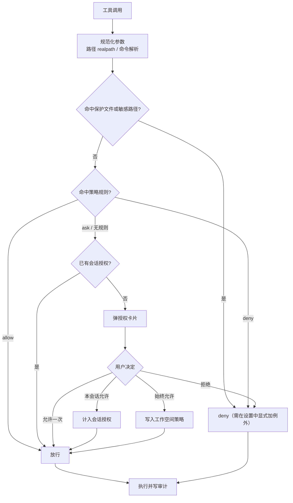

#### 5.5.2 策略来源与优先级

1. 内置硬规则（不可覆盖）：保护文件、敏感路径 deny。
2. 工作空间策略 `.hu/settings.json`（可随工作空间同步；团队/组织策略下发为后续能力 D11）。
3. 全局策略 `~/.hu-agent/config.json`。
4. 会话授权（内存，关会话即失效）。

规则形状（v1 支持 `tools` + `paths` + `action`，够用且可审查）：

```json
{
  "permissions": {
    "defaults": { "exec": "ask_once_per_session", "mcp": "ask_once_per_session" },
    "rules": [
      { "tools": ["read_file", "write_file", "edit_file"], "paths": ["<workspace>/**"], "action": "allow" },
      { "tools": ["bash", "powershell"], "paths": ["<workspace>/**"], "action": "allow" },
      { "tools": ["*"], "paths": ["~/.ssh/**", "~/.aws/**", "**/Keychains/**"], "action": "deny" },
      { "tools": ["read_file"], "paths": ["~/Documents/**"], "action": "ask" }
    ]
  }
}
```

#### 5.5.3 默认决策矩阵

| 操作 | 默认策略（Balanced，见 D6） |
| --- | --- |
| 工作空间内读取 / 写入 / 编辑 | allow |
| 工作空间内 `bash` / `powershell` | 本会话首次该命令类别时询问 |
| 工作空间外读取 | ask，可"始终允许该路径" |
| 工作空间外写入 | ask；敏感路径 deny |
| MCP 工具调用 | 本会话首次调用该工具时询问（外部行为不可静态分析） |
| 无路径概念的工具（如网络类 MCP） | 默认 ask，可按工具名加入 allow |

#### 5.5.4 路径沙箱规则

- 相对路径以工作空间根解析；所有路径经 `realpath` 解析后再与工作空间比较（防 `..` 与符号链接逃逸）。
- 符号链指向工作空间外视为越界操作，走审批；工作空间内的符号链循环需检测并报错。
- Windows 额外处理：大小写不敏感比较、`\\?\` 设备路径与 UNC 路径拒绝、8.3 短名展开后比较、保留设备名（CON/PRN/AUX/NUL/COM1…）拒绝。
- macOS 额外处理：Unicode 归一化（NFD/NFC）后比较。

#### 5.5.5 保护文件（Agent 不可写）

以下文件只能由用户在 UI 中修改，防止 Agent 自我提权：

`<workspace>/.hu/settings.json`、`<workspace>/.hu/mcp.json`、`<workspace>/.hu/skills.json`、`<workspace>/.hu/workspace.json`、`<workspace>/.hu/sync/**`、`<workspace>/.hu/logs/**`（含审计）、`<workspace>/.hu/backups/**`、`~/.hu-agent/config.json`、`~/.hu-agent/workspaces.json`、`~/.hu-agent/installed.json`、`~/.hu-agent/secrets.enc.json`。

工具调用命中这些路径时直接返回 `denied`，错误信息说明"该文件受保护，请在设置界面修改"。

#### 5.5.6 Shell 的诚实声明

`bash` / `powershell` 本质上是任意代码执行，路径沙箱只能"尽力而为"（控制 `cwd`、拒绝明显越界命令、控制环境变量）。因此：

- 默认策略下 shell 是审批弹窗最多的类别，属于预期行为；
- 审核时展示完整命令、`cwd`、解释描述，不做指令隐藏；
- 未来可选 OS 级沙箱（macOS App Sandbox / Windows AppContainer），见 D7。

#### 5.5.7 审计日志

每次决策写 `.hu/logs/audit.jsonl`（不进同步、不可被 Agent 修改）：

```json
{"ts":"2025-10-13T09:00:00Z","sessionId":"01J...","toolCallId":"t1","tool":"bash","argsDigest":"sha256:...","summary":"npm run build","decision":"allow_session","scope":"workspace"}
```

`summary` 只记录命令或路径，不记录文件内容；`argsDigest` 用于对账。

### 5.6 Workspace（工作空间）

#### 5.6.1 生命周期

1. **选择目录**：用户从客户端选择本地目录；若目录下无 `.hu/`，初始化（生成 `workspace.json`、目录骨架、`.gitignore` 类排除提示）。
2. **打开**：应用维护多个已知工作空间，索引存于 `~/.hu-agent/workspaces.json`（工作空间列表 + `activeId`）；同一时刻只有一个活跃工作空间（v1 不支持多工作空间并行会话）。
3. **关闭/切换**：切走时结束活跃 session；允许运行中会话被取消。

`workspace.json` 示例：

```json
{
  "id": "ws_01J8XYZ",
  "name": "backend-service",
  "createdAt": "2025-10-13T08:00:00Z",
  "server": {
    "workspaceId": "8f0c...",
    "teamId": "3a1b...",
    "syncEnabled": true,
    "lastSyncedVersion": 12,
    "lastSyncedDigest": "sha256:..."
  },
  "syncExclude": [".hu/sync", ".hu/logs", "node_modules", ".git", "dist", ".venv"]
}
```

> 阶段 2 实现字段为 `{ id, name, root, createdAt }`；`server`（云同步状态）与 `syncExclude` 在阶段 6 加入。已存在的目录若已含 `.hu/workspace.json`，则沿用其中的 `id` 与名称。

#### 5.6.2 上传文件与引用

- 用户拖拽/选择文件到会话或文件面板，即完成两步：
  1. 拷贝到 `<workspace>/uploads/<YYYY-MM-DD>/<安全化文件名>`（重名追加 `-1`、`-2`）；
  2. 向当前会话追加一条用户消息（附相对路径列表）。
- 图片可直接内联给具有视觉能力的模型（以工作空间内文件引用发送，不写入 JSONL 正文）。
- 从工作空间外部直接引用（不拷贝）：仅允许用户手动选择，并在会话中记录授权来源。

---

### 5.7 Skill 系统

#### 5.7.1 Skill 定义与包格式

Skill 就是一个目录（可打包为 `.hskill` = zip）：

```
pdf-report/
  SKILL.md              # 必需：元数据 + 使用说明
  scripts/build.sh      # 可选：可执行脚本
  references/api.md     # 可选：参考文档
  assets/...            # 可选：其他资源
```

`SKILL.md` front matter（服务端只解析 front matter 用于市场展示，不解析正文）：

```yaml
---
name: pdf-report
description: 将工作空间内的 Markdown 报表导出为 PDF
version: 1.2.0
when_to_use: 当用户要求导出 PDF、生成报表、排版打印时
requires:
  tools: [bash, read_file, write_file]
  bins: [pandoc]
  network: false
tags: [report, document]
min_app_version: 0.5.0
---

## 使用说明

1. 读取 `templates/report.md` ...
```

约束：`name` 全局唯一（小写字母、数字、连字符，≤ 64 字符）；`version` 为 semver；包大小 ≤ 20 MB、文件数 ≤ 500（服务端校验，见 6.4）。

#### 5.7.2 本地安装结构与优先级

```
~/.hu-agent/                     # Global
  installed.json                 # { "skills": [{"name","version","source":"market","skillId","installedAt"}] }
  skills.json                    # Global 启用状态
  skills/<name>/<version>/       # 各版本并存，可回滚；也支持无版本的 skills/<name>/SKILL.md
<workspace>/.hu/                 # Workspace
  skills/<name>/<version>/       # 同上
  skills.json                    # Workspace 启用状态（优先级高于 Global）
```

启用状态文件（每个作用域各一份，scope 由文件位置隐含）：

```json
{
  "enabled": [
    { "name": "pdf-report", "version": "1.2.0" }
  ]
}
```

优先级与冲突：

- Workspace 同名 Skill 覆盖 Global（扫描时以工作空间为准）；
- 同作用域内同名的多个版本：默认激活最高 semver，用户可固定版本（"使用该版本"）；
- 未启用的 Skill 只参与列表，不进上下文（不注入系统提示）。

#### 5.7.3 加载与激活

- 会话开始时读取已启用列表 + 各自 `SKILL.md` front matter；系统提示注入 `name / description / when_to_use / 绝对路径`。
- 模型判断相关时自行 `read_file` 读 `SKILL.md` 正文与引用文件（渐进披露，避免提示词膨胀）。
- Skill 目录属于工作空间/全局受信目录，`read_file` 对其自动 allow（写入仍按普通规则）。
- Skill 声明的 `requires` 仅作提示与安装校验（如检测缺失的二进制），不自动授杈。

#### 5.7.4 市场客户端流程

| 操作 | 流程 |
| --- | --- |
| 浏览 | `GET /marketplace/skills`（默认范围：我所在团队；支持关键字/标签/组织筛选）；结果本地缓存 1h |
| 详情 | 展示 front matter + README/`SKILL.md` 预览、版本列表、更新日志、声明权限 |
| 下载/安装 | 下载 zip → 校验 sha256 与签名 → 安全解压（防 zip-slip / zip 炸弹）→ 写入 Global 目录 → 记 `installed.json`（默认不自动启用） |

> 实现说明（阶段 5-05）：客户端使用自研最小 ZIP 读取器（`node:zlib`，不新增依赖）：只支持 stored/deflate，
> 拒绝加密条目、Zip64、绝对路径/`..`/反斜杠/盘符、符号链接，限制文件数/单文件体积/解压总量/压缩比，
> 并对每个条目做 CRC 校验；安装落 `~/.hu-agent/skills/<name>/<version>/`（先写临时目录再原子重命名），
> `installed.json` 记录 `skillId/name/version/digest/installedAt`；同作用域同名多版本默认激活最高 semver。
| 更新 | 拉取最新 semver → 展示变更日志 → 下载新版本并存（不删旧版）→ 用户确认后切换激活版本 |
| 启用/禁用 | 独立选择作用域：Global 或当前 Workspace（可同时启用，Workspace 优先），写对应 `skills.json`；上报激活状态（见 5.10） |
| 卸载 | 从启用列表移除 + 删除目录；已有会话不受影响 |
| 离线 | 已安装 Skill 全功能可用；市场操作需联网，明确提示 |

#### 5.7.5 信任与安全

- **内容即风险**：Skill 正文会进入模型上下文，可能引导模型执行危险命令。因此：
  1. 首次启用显式告知"该 Skill 包含脚本 / 声明需要 shell 权限"；
  2. Skill 引导的工具调用仍走统一权限引擎，不存在"启用即授权"；
  3. 市场来源的 Skill 均经过团队管理员审批，本地 Skill 由用户自行负责；
  4. 包 sha256 + 服务端签发元数据（后续可加签名，见 D8）。
- 安全解压规则：拒绝绝对路径、`..`、反斜杠路径、符号链接条目；解压总大小与压缩比限制（与 6.4 一致）。

### 5.8 MCP 集成

> ⚠️ MCP 客户端已换成 `pi-mcp`（`mcp/manager.ts`），支持 stdio 与 streamable HTTP；
> 自研客户端与过渡桥已删除。归属见 5.0。

#### 5.8.1 配置格式

Global：`~/.hu-agent/mcp.json`；Workspace：`<workspace>/.hu/mcp.json`。Workspace 同名 server **按字段覆盖** Global（只写 `enabled` 字段即可单独启停，`enabled.workspaces` 取并集）：

```json
{
  "servers": {
    "github": {
      "transport": "stdio",
      "command": "npx",
      "args": ["-y", "@modelcontextprotocol/server-github"],
      "env": { "GITHUB_TOKEN": "secret://keychain/hu-agent/github-token" },
      "enabled": { "global": true, "workspaces": ["ws_01J8XYZ"] },
      "source": { "type": "market", "mcpId": "...", "version": 3 },
      "approval": "session"
    },
    "jira": {
      "transport": "http",
      "url": "https://mcp.example.com/jira",
      "headers": { "Authorization": "secret://keychain/hu-agent/jira-token" },
      "enabled": { "global": false },
      "approval": "ask"
    }
  }
}
```

密钥**永不落配置文件**：`secret://keychain/<service>/<account>` 引用客户端密钥库（阶段 1 实现为 Electron safeStorage 加密文件，见 5.9 与 ADR 0002）；上报/同步均不包含密钥。

#### 5.8.2 连接与工具发现

- 会话启动或用户首次触发时建立连接：stdio 拉起子进程；SSE/HTTP 直连；连接失败则该 server 工具不可用并在 UI 告警。
- 握手后 `tools/list` 获取工具清单（支持 cursor 分页，最多 20 页），统一命名 `mcp__<server>__<tool>`，注入模型工具定义；工具描述过长时截断到 1000 字符。
- MCP 工具调用同样经过权限引擎（默认策略：每个工具本会话首次调用询问 + 结果脱敏提示）。
- 生命周期：空闲 10 分钟断开 stdio 子进程；崩溃自动重连最多 3 次并退避（500ms/1s/2s）；会话结束统一回收。

实现要点（阶段 3-03/3-04）：

- 传输为换行分隔 JSON-RPC 2.0；`initialize` 握手超时 60s（`npx -y` 首次拉包可能较慢），`tools/call` 超时 120s，超时错误带上 stderr 末尾便于定位。
- Windows 下 `npx`/`uvx` 等为 `.cmd` 包装，子进程经 `cmd.exe /d /s /c` 拉起；参数做 Windows 引号转义；回收时终止整个进程树（`taskkill /T`）。
- `secret://keychain/<service>/<account>` 在连接前解析为真实值；UI 输入的明文密钥写入密钥库后配置里只留引用。
- 应用启动与工作空间切换时后台预热连接；MCP 页面展示每个 server 的状态、工具数、最后错误与「测试连接」结果。

#### 5.8.3 市场交互

| 操作 | 流程 |
| --- | --- |
| 浏览 | `GET /marketplace/mcp-servers`，展示描述、传输方式、环境变量要求、变更记录 |
| 安装 | 获取配置模板 → 本地生成 `mcp.json` 条目 → 引导填写密钥（写入 safeStorage 密钥库） |
| 启用/禁用 | Global 与 Workspace 可独立配置（Workspace 同名覆盖 Global）；写 `enabled` 字段，下一会话生效；已运行会话提示重启工具连接 |
| 更新 | 拉取新版本描述与配置模板；若 `env_schema` 新增必填项，强制引导补齐；保留旧配置快照便于回滚 |

### 5.9 本地大模型配置（Global）

> ⚠️ provider 配置已改成 pi 的 `models.json` 格式（薄适配加载，见 `model/pi_config.ts`），
> 与 pi CLI 的配置可互换；企业模式由服务端持密钥。归属见 5.0。

```json
{
  "providers": [
    {
      "id": "openai",
      "apiType": "openai-chat",
      "baseUrl": "https://api.openai.com/v1",
      "apiKeyRef": "secret://keychain/hu-agent/openai",
      "models": [
        {
          "name": "gpt-4o",
          "capabilities": { "tools": true, "vision": true, "contextWindow": 128000, "maxOutput": 16384 },
          "roles": ["primary"]
        },
        {
          "name": "gpt-4o-mini",
          "capabilities": { "tools": true, "reasoningEffort": true, "contextWindow": 128000, "maxOutput": 16384 },
          "roles": ["fast"]
        }
      ]
    },
    {
      "id": "local-ollama",
      "apiType": "openai-chat",
      "baseUrl": "http://127.0.0.1:11434/v1",
      "apiKeyRef": null,
      "models": [{ "name": "qwen2.5:14b", "capabilities": { "tools": true, "contextWindow": 32768 } }]
    }
  ],
  "defaults": { "primary": "openai/gpt-4o", "fast": "openai/gpt-4o-mini" },
  "reporting": { "enabled": true, "priceTableSource": "server" }
}
```

要点：

- **API 接入类型（`apiType`）**：`openai-chat`（Chat Completions）、`openai-responses`（Responses API）、`anthropic-messages`（Anthropic Messages API）；大多数厂商支持前两者之一，在模型设置中按供应商选择。适配层负责消息结构、工具定义、流式事件与思考强度的协议差异（ADR 0003）。部分厂商同时提供多种协议（如 DeepSeek 的 Anthropic 兼容入口为 `https://api.deepseek.com/anthropic`），可用同一模型配置切换 apiType 验证。
- Provider 类型：三种 apiType 均内置于网关；`openai-chat` 自动兼容 OpenAI / Azure / vLLM / Ollama / DeepSeek 等；"是否支持 tools/vision"由用户在模型能力中声明，客户端只做能力提示。
- 密钥存储（阶段 1 已实现）：`apiKeyRef` 指向客户端密钥库；实现为 Electron safeStorage（加密密钥由 Windows DPAPI / macOS Keychain 保护）加密后写入 `~/.hu-agent/secrets.enc.json`，配置文件、日志与上报中永不出现明文（ADR 0002）。
- "快速模型"用于会话标题、历史压缩、ask_guide 生成等低价值调用（也计入用量上报，标记 `purpose: fast`）。
- 思考强度：模型声明 `capabilities.reasoningEffort = true` 后，会话可选择 关闭/低/中/高（见 5.2.6）；协议映射：OpenAI 系 `reasoning_effort`（chat）/ `reasoning.effort`（responses），Anthropic 为 `thinking.budget_tokens`（低 2048 / 中 8192 / 高 16384）；Anthropic 工具续轮时必须按 API 要求回传 thinking 块与 signature，已随会话 JSONL 持久化。
- 模型不可用时的降级：按配置顺序回落，全部失败则提示用户（不静默切到本地小模型）。
- 中转/代理：支持 `baseUrl` 指向企业网关；不支持客户端级 HTTP 代理配置（v1 直接用系统代理）。
- 未来可选服务端下发模型白名单/默认模型（企业统一管控，见 D11）。

### 5.10 用量上报

#### 5.10.1 本地记账与队列

- 每次模型调用结束（含错误）生成一条事件，追加到 `.hu/telemetry/queue.jsonl`。
- 批量上报：最多 100 条/批，`event_id`（UUIDv7）幂等；成功则记录确认位点，失败指数退避（1m/5m/30m/2h，上限 1 天），本地保留 7 天、上限 50 MB（超出丢最旧并记日志）。
- 未登录/未配置服务器时不入队（隐私默认），登录后开始上报；设置页可查看待上报数量与手动清空。

实现要点（阶段 4-04）：

- 确认位点存 `.hu/telemetry/queue.pos`（字节偏移，追加写保证稳定）；已发送部分超过文件一半且大于 5MB 时压实重写，避免无限增长。
- 退避状态存 `.hu/telemetry/state.json`（失败次数 + 上次尝试时间）；定时器每 60s 扫描一次，只处理积压且到达重试时间的工作空间；用户「立即上报」忽略退避。
- `sessionIdHash` 盐值存 `.hu/telemetry/salt`（每工作空间随机 16 字节），事件里的 `workspaceId` 在云同步（阶段 6）建立服务端工作空间 UUID 前统一上报为 `null`，避免被归属校验置空。
- 上报失败不得影响对话：入队与上报都为后台任务，异常只记日志。

#### 5.10.2 事件字段

```json
{
  "eventId": "01J...",
  "occurredAt": "2025-10-13T09:00:00.000Z",
  "deviceId": "...",
  "appVersion": "1.3.0",
  "workspaceId": "8f0c...",
  "teamId": "3a1b...",          // 工作空间关联的团队，可空
  "sessionIdHash": "sha256:...",  // 会话 id 加盐哈希，仅用于去重，不可反推
  "purpose": "primary",         // primary | fast
  "provider": "openai",
  "model": "gpt-4o",
  "inputTokens": 1200,
  "outputTokens": 350,
  "cacheReadTokens": 0,
  "cacheWriteTokens": 0,
  "reasoningTokens": 0,          // 若有
  "requests": 1,
  "durationMs": 3120,
  "status": "success",           // success | error
  "errorCode": null
}
```

隐私边界（写入产品说明）：**不上报提示词、回复内容、文件路径、工具参数**；`sessionIdHash` 带随机盐（每工作空间一个盐，存于本地）防止跨库关联。

#### 5.10.3 激活状态上报（用于"谁启用了什么"统计）

启用/禁用 Skill、MCP 时，以及每日首次联网时，上报当前设备的完整激活快照（幂等、全量覆盖该设备）：

```json
{
  "deviceId": "...",
  "reportedAt": "2025-10-13T09:00:00Z",
  "scope": "global",            // global | workspace
  "workspaceId": null,          // scope = workspace 时必填
  "items": [
    { "type": "skill", "source": "market", "refId": "skill_uuid", "name": "pdf-report", "version": "1.2.0", "enabled": true },
    { "type": "mcp", "source": "market", "refId": "mcp_uuid", "name": "github", "version": 3, "enabled": false },
    { "type": "skill", "source": "local", "refId": null, "name": "my-notes", "version": "0.1.0", "enabled": true }
  ]
}
```

服务端按 `(user_id, device_id, scope, workspace_id, type, ref_key)` 保存最新状态，统计时按用户聚合（任一设备启用即计为启用，同时展示设备明细与本地未上架资源计数）。

### 5.11 工作空间云同步

#### 5.11.1 目标与约束

- 目标：换机器/重装后可完整恢复工作空间；团队内可存档。
- 粒度：**整体 zip 快照**，不做文件级差分合并（明确取舍，避免冲突地狱）。
- 不可变：每个快照上传后不可修改；回滚=下载旧快照覆盖本地（先备份）。
- 默认单写者：同一工作空间多人同时同步时，后提交者必须基于最新版本重新提交（乐观锁）。

#### 5.11.2 上传流程

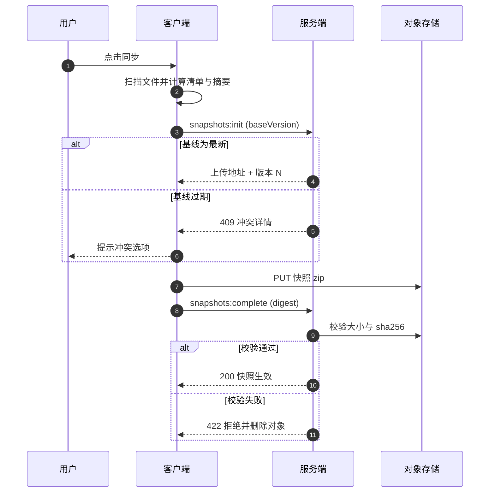

当服务端开启扫描校验（默认）时，服务端会校验 zip 结构合法、不含危险路径、大小与清单一致；扫描失败直接拒绝。

> 实现要点（阶段 6-02）：
> - `manifest_digest` 只包含「相对路径 + 文件大小」，保证**跨机器可比**（用于冲突信号与列表展示）；
> - 本地脏检查在摘要之外再比对 `mtime`（含文件集变化），否则同尺寸内容修改（改一个字符）会被漏检；
> - 回滚到旧版本后置 `dirty` 标记：视为一笔新的本地改动，下次同步会把回滚结果作为新版本上传，
>   而不是立刻被服务端最新版覆盖（避免数据丢失）；
> - 预签名 PUT 必须带 `Content-Length`（否则 MinIO 返回 411），上传使用流式 body。

#### 5.11.3 下载与冲突处理

- `GET /workspaces/{id}/snapshots/latest` → 预签名下载 → 客户端先下载到 `sync/staging/` 校验，再应用；需要文件级差异时用 `?withManifest=true` 获取文件清单。
- 应用前检查本地是否有未同步修改（对比 `state.json` 的 `lastSyncedDigest` 与实际文件清单）：
  - 无修改：直接覆盖，旧文件先全量备份到 `.hu/backups/pre-restore-<ts>/`。
  - 有修改：默认**阻塞**，提供三个选项：① 保留本地副本后覆盖（副本存入 `sync/conflicts/<ts>/`）；② 取消；③ 导出差异清单（文件级）供人工合并。
- 不做自动三方合并（v1 明确定义）。

> 实现要点（阶段 6-02）：覆盖前先备份到 `.hu/backups/pre-restore-<ts>/`（先拷贝到系统临时目录再移入，
> 避免「拷贝到自身子目录」）；保留本地副本写入 `.hu/sync/conflicts/<ts>/`；导出差异写入
> `.hu/sync/conflicts/diff-<ts>.json`；按快照清单清理本地多余文件，但 `.hu/sync|logs|backups` 始终保留。
> v1 在内存中解压快照（上限 256 MB，超过提示使用排除规则），流式解压留待 v1.x。

#### 5.11.4 同步范围与限制

| 项目 | 默认值 |
| --- | --- |
| 包含 | 工作空间全部普通文件 + `.hu/sessions` + `.hu/settings.json`（会话默认包含，可排除） |
| 排除 | `.hu/sync`、`.hu/logs`、`.hu/backups`、`node_modules`、`.git`、`dist`、`.venv`、以及 `workspace.json` 中用户自定义的 `syncExclude` |
| 单快照大小 | ≤ 2 GB（超出提示用户用排除规则） |
| 文件数 | ≤ 50,000 |
| 版本保留 | 默认保留最近 20 个版本；可标记"永久保留"；超限由 worker 清理（先删对象后删记录） |
| 存储配额 | 按用户/团队配置（服务端强制） |

#### 5.11.5 同步触发方式（手动 + 定时，D5）

已确认：支持手动同步与定时同步，不做客户端加密（D4）。

| 触发 | 行为 |
| --- | --- |
| 手动 | 用户点击"立即同步"：先拉取服务端最新版本信息 → 按 5.11.3 规则上传或下载 |
| 定时 | 设置项 `sync.schedule`：关闭 / 每 15m / 30m / 1h / 6h / 24h（默认关闭） |

定时同步执行规则（客户端同步引擎）：

1. 前置条件：已登录、网络可用、无进行中的同步（单飞锁）。
2. 脏检查：扫描工作空间清单与 `state.json.lastSyncedDigest` 比对，无变更则不产生任何请求。
3. 有本地变更：执行 5.11.2 上传流程；服务端有更新版本时执行 5.11.3 下载流程。
4. 冲突：暂停定时同步并在 UI 提醒，直到用户处理（绝不自动覆盖）。
5. 失败：不弹窗，自动重试 1 次；状态栏显示上次同步结果，连续失败 3 次提醒。

> 实现要点（阶段 6-04）：档位存于 `<ws>/.hu/sync/settings.json`（本地专用，不参与快照），
> 每次 tick 现取当前工作空间与档位；单飞锁在引擎内（同一工作空间并发调用直接返回当前状态）；
> 冲突时调度器自动暂停，用户处理完冲突（`sync:resolve`）后重新武装；失败静默重试一次，
> 连续失败 3 次在状态里追加提醒；自动同步结果通过 `sync:event` 实时推送到界面。
> 空闲时每次 tick 只做一次 `latest` 查询（用于发现服务端新版本），本地无变更不会产生写请求。

#### 5.11.6 加密（D4 已确认：不加密）

- 传输：全链路 HTTPS/TLS。
- 存储：不引入客户端端到端加密，也不额外做应用层加密；快照与包以原始 zip 存储，依赖部署方的磁盘/存储静态加密能力（由运维决定）。
- 明确风险：服务端具备读取快照与 Skill 包内容的能力，依靠访问控制（仅 owner 可读、预签名 URL 短时效）与审计约束。
- 预留：快照记录保留 `encrypted` 字段，后续如需要可平滑升级，不影响协议。

### 5.12 资源状态同步与下架 / 禁用处理

> 回答设计讨论：客户端已启用的市场资源（Skill / MCP）如何感知服务端下架、停用、删除。

#### 5.12.1 原则

- **用户意图与服务端状态分离**：本地保存“用户是否启用”（intent），服务端返回资源可用状态（state），实际生效 = intent ∧ state 允许。
- **服务端权威、客户端自治**：服务端状态是权威的；但离线时客户端沿用最后已知状态，不因断网失效。
- **分级处理**：下架是“不再分发”（软），停用 / 撤回版本 / 删除是“立即停止使用”（硬）。
- **可恢复**：资源恢复后，客户端按用户原意图恢复启用并提示，不要求用户重新手动启用。

#### 5.12.2 本地状态模型

```json
{
  "type": "skill",
  "name": "pdf-report",
  "enabled": true,
  "source": { "refId": "uuid", "version": "1.2.0", "revision": 123 },
  "serverState": "active",
  "stateReason": null,
  "stateCheckedAt": "2025-10-13T09:00:00Z"
}
```

| `serverState` | 含义 | 生效规则 |
| --- | --- | --- |
| `active` | 正常 | 按用户意图生效 |
| `delisted` | 已下架（不再分发/更新） | 继续可用，标记“已下架”，停止更新检查 |
| `disabled` | 管理员停用 / 团队归档 / 组织冻结 | 硬停用：移出系统提示、断开 MCP 连接 |
| `revoked` | 当前版本被撤回（安全事件） | 硬停用该版本；有替代版本则提示升级 |
| `not_found` | 已删除，或已不在可见范围（被移出团队等） | 硬停用 |
| `unknown` | 检查失败（网络等） | 不改状态，沿用上次已知值并标记“状态未同步” |

> 实现说明（阶段 5-07）：客户端缓存 `~/.hu-agent/resource-status.json`（按 `skillId` 存 status/reason/
> replacementVersion/revision/checkedAt）；检查时机：启动后 30s、每 6 小时、打开市场页与启用前（手动触发），
> 本地缓存 15 分钟内不重复请求；状态进入硬停用时追加本地审计
> `~/.hu-agent/logs/resource-status.jsonl`；**硬停用不修改用户意图**（`skills.json` 不动），
> 仅使 `enabled = 意图 ∧ 状态允许`，恢复后自动回到原意图。

#### 5.12.3 感知机制

客户端批量上报本地市场资源清单，服务端逐项返回状态（`POST /resources/status:check`，≤ 100 条）：

```json
// 请求
{ "items": [
  { "type": "skill", "refId": "uuid", "version": "1.2.0" },
  { "type": "mcp", "refId": "uuid", "version": 3 }
] }

// 响应
{ "checkedAt": "2025-10-13T09:00:00Z", "items": [
  { "type": "skill", "refId": "uuid", "version": "1.2.0",
    "status": "revoked", "reason": "该版本存在安全问题，请升级",
    "replacementVersion": "1.2.1", "revision": 456 }
] }
```

检查时机（客户端）：

1. 应用启动后（在线时延迟 30s，不阻塞启动）。
2. 每 6 小时（可在设置调整）。
3. 打开市场页、启用某资源前、会话开始时（缓存超过 15 分钟才重新请求）。
4. 收到关联通知时主动复查。

#### 5.12.4 处理与 UX

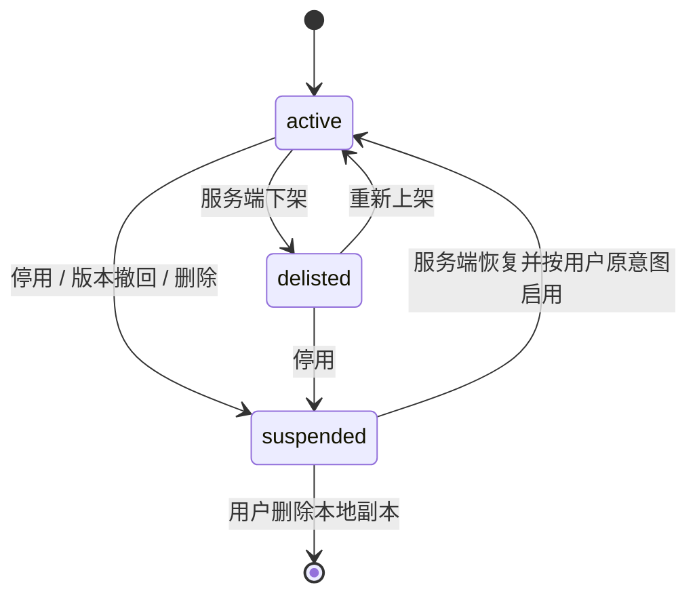

- 资源列表与聊天输入区显示状态徽标；被硬停用的资源在资源页展示原因与申诉入口（联系管理员）。
- Skill：从系统提示的 Skill 目录中移除，但保留本地文件（便于恢复与审计）。
- MCP：立即关闭连接、移除工具；进行中的调用等待完成或由用户取消。
- 服务端同时向受影响用户（曾上报 `enabled=true` 者）发站内通知，降低对轮询间隔的依赖。
- 本地审计记录 `.hu/logs/audit.jsonl`：`resource_state_change`（name、refId、from、to、reason、checkedAt）。

#### 5.12.5 离线与强管控（D14）

- 默认：离线时沿用最后已知状态（local-first，可用性优先）。
- 企业可选开启 `enforcement.maxStalenessHours`：状态超过 N 小时未校验则禁止使用市场资源（默认关闭）。
- 诚实地说明：该机制无法阻止用户手动使用本地文件，属于协作式管控，不是强制 DRM。

### 5.13 国际化

- 客户端 UI 支持 `zh-CN` / `en-US`（D13），可切换、默认跟随系统。
- Agent 系统提示注入当前语言，模型默认使用该语言回复（Skill 可显式指定输出语言）。
- 服务端错误返回业务码（见 6.9.1），由客户端本地化文案；通知与邮件按 `users.locale` 渲染。

#### 5.13.1 实现说明（v1.0）

**目录与词典**

- 内核在 `app/src/shared/i18n/`，主进程与渲染层共用一份词典（`en-US.ts`）。
- **中文原文即消息键**（gettext 的 msgid 模型）：`zh-CN` 无需词典（插值后直接返回键），
  新增中文文案立即生效不会漏翻；英文只需维护「中文 → 英文」一张表。
- 渲染层：`app/src/renderer/src/i18n.ts` 持有当前语言并由根组件 `useI18n()` 订阅，
  语言切换时根组件重渲染带动整树（避免为数百条文案在每个组件里挂 hook）。
- 主进程：`app/src/main/i18n.ts` 提供 `t()`；启动时（创建窗口前）初始化，
  所有用户可见文案（错误、对话框、日志）均走 `t()`。
- **模型面向文案保持单一语言**：系统提示、压缩指令与工具描述不翻译（避免翻译影响提示词质量），
  仅由 5.2.3 注入「回复语言」指令；见 `app/scripts/i18n-config.mjs` 的白名单。

**语言偏好与同步**

- 偏好存 `~/.hu-agent/config.json` 的 `ui.locale`（`system` = 跟随操作系统）；
  与模型配置同文件，读写采用「读取 → 合并 → 原子写回」以免互相覆盖。
- 切换语言后客户端调用 `PATCH /me { locale }` 同步 `users.locale`，用于服务端通知与邮件；
  离线或未登录时静默失败（本地语言已生效）。
- 服务端站内通知**在写入时**按收件人 `users.locale` 渲染（`domain/messages.py`：kind + 参数 → 标题/正文，
  支持 `{name}` 与 `{name|默认值}` 占位符）；调用方只传 kind 与参数，不再拼中文文案，
  审批类型等内部标识在渲染时映射为本地化名称。历史通知保留写入时语言（可预期、读取零成本）。
- 管理台语言偏好存 `localStorage`，用户设置页（5-09）完成后改为写入 `users.locale`。

**错误码本地化**

- 客户端按业务码取词（`app/src/shared/i18n/error-codes.ts`）：
  中文界面优先用服务端原文（服务端文案本就是中文且更具体），其他语言用本地化文案，
  不把服务端中文混入英文界面。

**防漏翻（可验证）**

- `app/scripts/i18n-scan.mjs` 基于 TypeScript AST 找出「应翻译但未包 `t()`」的文案；
  该扫描同时服务迁移工具与 `app/tests/i18n.test.ts`（CI 强制）：
  ① 源码用到的键必须在词典中；② 词典不得有死键或重复键；③ 占位符集合一致；
  ④ 译文不得残留中文；⑤ 渲染层与主进程（模型面向文件除外）不得有未包裹文案。

## 6. hu-agent-management 详细设计

### 6.1 工程与服务结构

```
management/                     # Python 3.14 单包项目（uv 管理）
  pyproject.toml                # 项目元数据、依赖、入口脚本、mypy 配置
  uv.lock                       # 锁定依赖版本（提交入库）
  ruff.toml                     # ruff（lint）独立配置
  pytest.ini                    # pytest 独立配置
  src/huagent/
    common/                     # 错误码 / 配置 / 通用工具
    api/                        # FastAPI 应用与路由（auth/orgs/teams/skills/...）
    domain/                     # 领域服务与数据访问（SQLAlchemy）
    storage/                    # S3/MinIO 封装（预签名、流式摘要校验）
    worker/                     # 定时任务入口（APScheduler）
  tests/
```

领域包划分（按领域垂直切分；模块间只允许通过 application service 接口调用，禁止跨领域直接访问对方仓储/表）：

`auth` · `users` · `orgs` · `teams` · `invitations` · `approvals` · `skills` · `mcp` · `marketplace` · `workspaces` · `snapshots` · `usage` · `stats` · `notifications` · `audit` · `admin`

技术实现约定：SQLAlchemy 2.0 async + psycopg 3（复杂查询直接写参数化 SQL，禁止字符串拼接）；schema 由编号 DDL 脚本手工维护（见 6.8.3），应用启动不自动改表；限流用 Redis 令牌桶；API 文档由 FastAPI 自动生成 OpenAPI 3.1，供管理台与客户端生成 TypeScript 调用代码；工具链用 uv（`uv sync` / `uv run`），lint/format/type 用 ruff + mypy，测试用 pytest。

### 6.2 权限设计（RBAC）

#### 6.2.1 角色模型

角色不是用户属性，而是**成员关系上的属性**，天然支持多组织：

| 实体关系 | 角色 | 说明 |
| --- | --- | --- |
| `users.is_system_admin` | 系统管理员 | 全局唯一最高权限，系统初始化时内置 |
| `org_members.role` | `admin` / `member` | 组织内角色 |
| `team_members.role` | `admin` / `member` | 团队内角色 |

约束与规则：

- 一个用户可属于多个组织；一个组织可包含多个团队；一个团队只能属于一个组织。
- 组织创建人自动成为该组织 `admin`；团队创建人自动成为该团队 `admin`。
- 组织管理员默认不是团队成员，但拥有组织内团队资源的**合规越权**（审阅/下架/删除任意团队资源），所有越权操作强制写审计。
- 系统管理员可以管理组织生命周期（冻结/解冻/删除），但**默认看不到组织内的会话/快照内容**（服务端也不应该存储明文对话）。
- 最后一个组织管理员不能被移除/降级（除非先指定新管理员或解散组织）。

#### 6.2.2 权限点清单

| 权限点 | 系统管理员 | 组织管理员 | 团队管理员 | 成员 |
| --- | :-: | :-: | :-: | :-: |
| `org.apply`（申请创建组织） | — | — | — | ✓ |
| `org.approve`（审批组织创建） | ✓ | — | — | — |
| `org.manage`（改名/冻结/解散） | ✓ | ✓ | — | — |
| `org.member.invite` / `remove` | — | ✓ | — | — |
| `team.apply` | — | — | — | ✓（组织成员） |
| `team.approve` | — | ✓ | — | — |
| `team.manage` | — | ✓（越权） | ✓ | — |
| `team.member.invite` / `remove` | — | ✓（越权） | ✓ | — |
| `skill.submit` | — | — | ✓ | ✓ |
| `skill.review` / `publish` / `delist` / `delete` | — | ✓（越权） | ✓ | — |
| `mcp.submit` | — | — | ✓ | ✓ |
| `mcp.review` / `publish` / `delist` / `delete` | — | ✓（越权） | ✓ | — |
| `workspace.sync` | — | — | — | ✓（本人） |
| `stats.self` | ✓ | ✓ | ✓ | ✓ |
| `stats.team` | — | ✓（越权） | ✓ | — |
| `stats.org` | — | ✓ | — | — |
| `stats.global` | ✓ | — | — | — |
| `audit.view` | ✓（全局） | ✓（本组织） | — | — |
| `system.settings` | ✓ | — | — | — |

#### 6.2.3 鉴权实现

- 统一入口：`authorize(actor, action, resource)`；`resource` 携带 `orgId / teamId / ownerId` 用于数据范围断言。
- 成员关系缓存 Redis 30s；角色变更时 bump `users.roles_version`，access token 与 DB 不一致时强制刷新（令牌只作为身份凭证，权限每次查）。
- 所有列表接口强制带数据范围过滤（SQL 层拼 `WHERE`，不允许应用层过滤后再分页）。
- 对象级断言：skill/mcp 的读权限 = 同在团队；下载链接预签名 TTL 5 分钟且仅生成本人可见链接。

### 6.3 审批流

#### 6.3.1 通用模型

只做一套通用审批表 + 按类型校验载荷，不引入工作流引擎：

```
approval_requests(
  id, type, requester_id, org_id, team_id,
  target_type, target_id,
  payload jsonb,            -- 提交快照（供审核与回溯）
  status,                   -- pending | approved | rejected | cancelled
  reviewer_id, review_comment,
  created_at, decided_at
)
```

type 枚举：`org_create` / `team_create` / `skill_version_publish` / `mcp_version_publish`。

规则：

- 同一 target 同时只允许一个 `pending` 审批（唯一部分索引强制）。
- 申请人可在 `pending` 时撤回（`cancelled`）。
- 审核人必须是权限点持有者；审批通过/拒绝后发通知。
- 所有审批写入 `audit_logs`（含 payload 摘要）。
- 审批超时提醒：默认 48h 未处理提醒一次，7 天自动标记 `stale`（不自动通过）。

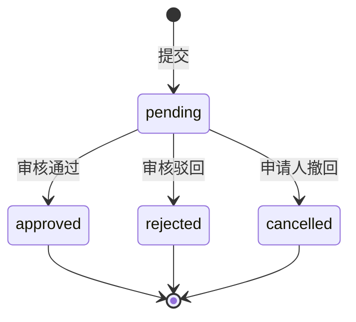

#### 6.3.2 组织创建

1. 任何已登录用户提交：`name / slug / description / reason`。
2. 系统管理员审批。
3. 通过后：创建 `orgs` 记录，申请人写入 `org_members(role=admin)`，slug 冲突时拒绝并提示。

#### 6.3.3 团队创建

1. 组织成员提交：`orgId / name / description / reason`。
2. 组织管理员审批。
3. 通过后：创建 `teams`，申请人写入 `team_members(role=admin)`。

#### 6.3.4 邀请

- 组织邀请：组织管理员发起，接收人加入组织为 `member`（可在邀请时直接指定 `admin`）。
- 团队邀请：团队管理员发起，**只能邀请本组织成员**（非组织成员时提示先入组织）。
- 邀请链接：一次性 token（存哈希），有效期 7 天；支持重发（旧链接失效）；接收人未注册时先注册再自动加入。

### 6.4 Skill 市场

#### 6.4.1 状态机（Skill 级 / 版本级）

- `skills.status`：`draft`（无已发布版本）→ `published` → `delisted` → `deleted`（软删）。
- `skill_versions.status`：`pending` → `published` / `rejected`；新版本发布后旧版本标记 `superseded`（仍可下载，用于固定版本）；安全事件时管理员可 `revoke` 已发布版本（客户端硬停用，见 6.4.5）。

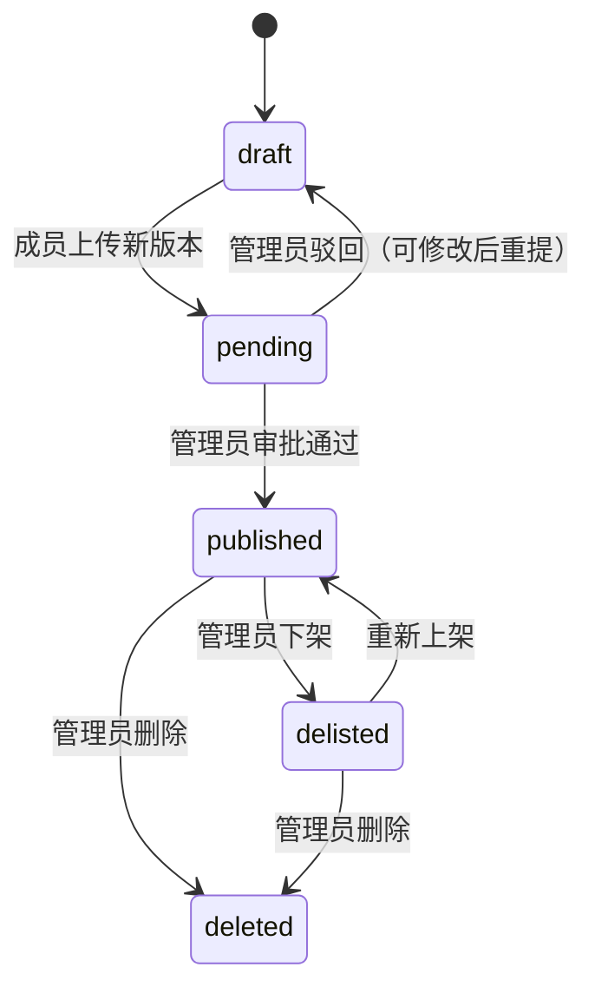

#### 6.4.2 上传与校验

`POST /teams/{id}/skills`（new-skill）或 `POST /skills/{id}/versions`（new-version）：

> 实现说明（阶段 5）：上传使用**原始 zip 请求体**（`Content-Type: application/zip`，流式读取并限制 20MB），
> 元数据由包内 `SKILL.md` front matter 提供，`changelog` 走查询参数；比 multipart 少一个依赖且同样流式安全。
> 对象存储经 `storage/objects.py` 抽象（生产 S3/MinIO，测试内存实现），首次写入自动确保桶存在。
>
> **必须按 `ZipInfo.orig_filename` 校验路径**：Python `zipfile` 的 `filename` 会把反斜杠归一化为 `/`
> （`orig_filename` 保留原样），只查 `filename` 会放过 Windows 压缩工具（如 PowerShell `Compress-Archive`）
> 产出的 `scripts\run.sh` 类包；已加单测固定该行为。

1. 流式接收，边收边算 sha256，同时限制最大 20 MB。
2. 结构校验：能被 zip 解析；根目录或单一顶层目录下存在 `SKILL.md`；拒绝绝对路径 / `..` / 反斜杠 / 符号链接条目；文件数 ≤ 500；解压后总大小 ≤ 100 MB；压缩比 ≤ 200:1（防 zip 炸弹）。
3. front matter 解析：名称合法且与已有不冲突、semver 版本、`requires` 结构合法；`min_app_version` 不高于当前客户端最低支持版本。
4. 同一 skill 不得同时存在两个 `pending` 版本。
5. 落对象存储：`skills/{orgId}/{teamId}/{skillId}/{version}/{sha256}.hskill`（对象先写后提交成功后置为可见；失败则删对象回滚）。
6. 创建 `skill_version(pending)` + `approval_request(skill_version_publish)`，通知团队管理员。

#### 6.4.3 审核视图

团队管理员需看到足够信息做出判断：

- front matter 全文 + `SKILL.md` 正文预览（服务端只做展示，不执行）；
- 文件列表（相对路径、大小、是否为可执行脚本）；
- 声明的 `requires.tools / bins / network`；
- 与上一已发布版本的**文件级 diff 摘要**（新增/修改/删除文件列表，不展示大文件 diff）；
- 安全提示：包含脚本、声明需要 shell、声明需要网络。

操作：`通过` / `驳回（必填意见）`。

#### 6.4.4 市场列表与下载

- 客户端可见范围：`发布的技能 ∈ 用户所在团队`；支持 `q`（名称/描述/标签，`pg_trgm` 索引）、tags、orgId、排序（更新/名称/下载量）。
- 详情接口返回：元数据、版本列表（含变更日志）、`SKILL.md` 预览、权限声明；**不返回包内容**。
- 下载：`GET /skills/{id}/versions/{version}` → 302 或 JSON 预签名 URL（TTL 5 分钟）→ 客户端校验 digest；下载次数记入 `skill_versions.download_count`。
- 下架/删除后：市场不再可见、不再接收新下载；客户端按“下架 = 软停用、删除 = 硬停用”分级处理（见 5.12、6.4.5）。

#### 6.4.5 资源状态变更与通知（Skill / MCP 通用）

- **修订号**：`skills.status_revision` / `mcp_servers.status_revision` 由全局序列递增，任何状态变更（发布/下架/停用/删除、版本撤回、团队归档、组织冻结）都会增长，用于客户端缓存判断与审计对账。
- **latest 指针回退**（实现约定）：撤回最新已发布版本时，`latest_published_version_id` 回退到上一可用版本（`published`/`superseded`），客户端仍按自己安装的版本查询，得到 `revoked` + `replacementVersion`。
- **生效状态推导**（`POST /resources/status:check` 内部逻辑，按优先级）：资源删除或不可见（被移出团队等）→ `not_found`；组织冻结 / 团队归档 / 管理员停用 → `disabled`；指定版本撤回 → `revoked`；资源下架 → `delisted`；否则 `active`。
- **可见性校验**：只返回调用者所属团队的资源；不在范围内的 refId 返回 `not_found`（兼容“被移出团队”场景）。
- **停用必填原因**：`disabled` / `revoked` 必须填写 `reason`（管理员在 UI 输入），随状态下发给客户端展示。
- **定向通知**：停用/撤回/删除时，向 `activation_reports` 中曾启用该资源的用户发站内通知（含原因与替代版本）；下架不发通知。
- **审计**：记录 `skill.disable` / `skill.revoke_version` / `mcp.disable` 等动作，含操作人、原因、影响用户数。
- **硬停用的边界**：客户端为协作式执行，无法阻止用户手动使用本地文件；服务端保证“不再分发 + 状态可见 + 审计留痕”。

### 6.5 MCP 市场

MCP 资源不包含代码包，只有**连接描述**与**配置模板**：

```json
{
  "name": "github",
  "description": "访问 GitHub 仓库与 PR",
  "transport": "stdio",
  "config_template": {
    "command": "npx",
    "args": ["-y", "@modelcontextprotocol/server-github"]
  },
  "env_schema": [
    { "key": "GITHUB_TOKEN", "label": "GitHub 个人访问令牌", "secret": true, "required": true,
      "help": "需 repo 读权限；访问 https://github.com/settings/tokens 创建" }
  ],
  "docs_md": "...",
  "transport_options": ["stdio", "http"],
  "version": 3,
  "changelog": "新增项目列表工具"
}
```

- 版本化与状态机与 Skill 一致（`mcp_servers` + `mcp_server_versions` + 同一审批流）。
- `env_schema.secret = true` 的项：服务端只存声明，**永远不接收、不存储值**；客户端引导用户写入 safeStorage 密钥库。
- 审核要点：外部域名是否可信、是否要求敏感权限（如全仓库 token）、是否声明了超出描述范围的权限。
- 上线后管理员可随时下架或停用；状态变更、定向通知与客户端硬停用机制与 Skill 共用（见 6.4.5、5.12）。

### 6.6 工作空间云同步服务

#### 6.6.1 资源模型

- `workspaces`：用户维度创建（可关联一个团队用于配额与统计），归属人 = 创建者。
- `workspace_snapshots`：不可变版本，`(workspace_id, version)` 唯一，`manifest_digest` + `digest` 双摘要。
- 权限：仅 owner 可读写；团队管理员可看到"使用了多少存储"，**看不到快照内容**（D12 已确认：工作空间个人所有）。

#### 6.6.2 接口与并发控制

| 接口 | 说明 |
| --- | --- |
| `POST /workspaces` | 客户端首次关联：`{name, teamId?, deviceId}` → `workspaceId` |
| `POST /workspaces/{id}/snapshots:init` | 乐观锁入口：携带 `baseVersion`；返回预签名 PUT 与 `snapshotId`（状态 `uploading`）；`baseVersion != latest` → 409 |
| `PUT <uploadUrl>` | 直传对象存储（单次 ≤ 2 GB；更大需要分片，v1 直接拒绝并提示） |
| `POST /snapshots/{id}:complete` | 服务端校验对象存在、大小、sha256（流式）→ `uploading` → `active`；失败删除对象 |
| `GET /workspaces/{id}/snapshots` | 版本列表（分页） |
| `GET /snapshots/{id}/download-url` | 预签名下载（TTL 15 分钟） |
| `POST /snapshots/{id}:pin` | 标记永久保留 |
| `DELETE /snapshots/{id}` | 仅允许删除非最新/未 pin 版本 |

超时与清理：`uploading` 状态超过 24h 的 snapshot 由 worker 删除对象并标记 `aborted`；快照未完成时不计入配额。

#### 6.6.3 配额与保留

- 配额维度：用户总量 → 团队总量（取交集，两项都不得超）。默认：单用户 10 GB，单团队 100 GB（可在系统设置中调整）。
- 超配额时 `snapshots:init` 返回 402 风格的业务错误（`QUOTA_EXCEEDED`）并附当前用量。
- 版本保留：默认最近 20 个；``pinned`` 不计入；清理任务只删对象与记录，不动当前最新。
- 团队解散/组织冻结：快照进入只读，不解冻不能上传（下载不受限，保障数据取回）。

### 6.7 用量与统计

#### 6.7.1 写入链路

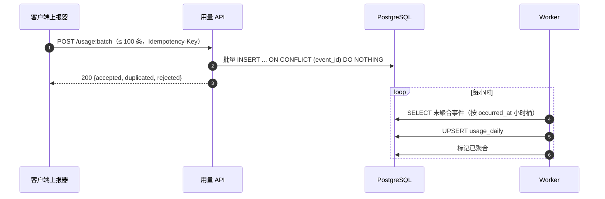

- 分区：`usage_events` 按月 `PARTITION BY RANGE (occurred_at)`，提前创建下月分区；原始数据保留 90 天（可配），到期 `DETACH` 后删除。
- 全量幂等：重复 `event_id` 静默忽略（计入 `duplicated`）。分区表唯一约束必须包含分区键，实际为 `UNIQUE (event_id, occurred_at)`；服务端先按 `event_id` 查已存在（`occurred_at` 用本批时间范围做分区裁剪），再插入，因此客户端重试即使 `occurredAt` 毫秒差异也不会重复入库；同批内重复 `event_id` 只收第一条。
- 服务端校验：`occurred_at` 不得超出 ±7 天；超出则计入 `rejected`（不阻断整批）；token 字段非负且单项 ≤ 10^9（超出由模型校验直接 422，归属不明的则不丢数据）。
- 归属解析：客户端上报的 `team_id` 必须已在服务端存在且用户是其成员，`workspace_id` 必须属于本人；否则该条归属置空并计入响应中的 `sanitized`（保留 token 数据以保证个人统计可对账，避免伪造团队归因）；组织由团队反推；无团队则为"个人"维度。

#### 6.7.2 统计维度

| 视图 | 维度 | 指标 | 权限 |
| --- | --- | --- | --- |
| 个人用量 | 日 / 模型 | input / output / cache / requests / 估算花费 | `stats.self` |
| 团队用量 | 成员 × 日 × 模型 | 同上 + 人均 | `stats.team` |
| 组织用量 | 团队 × 日 × 模型 | 同上 | `stats.org` |
| 全局用量 | 组织 × 日 × 模型 | 同上 | `stats.global` |
| 资源激活 | 用户 × Skill/MCP × 版本 | 启用状态、设备数、最后上报时间、服务端状态（active/delisted/disabled/revoked/not_found） | 分级同上看范围 |

价格：服务端维护 `model_prices(provider, model, input_per_1k, output_per_1k, cache_read_per_1k, cache_write_per_1k, currency, effective_from)`；旧数据按调用当时的生效价格估算（聚合时快照）。

> 实现要点（阶段 6-05/6-06/6-07）：worker 启动时先补偿执行一次聚合与分区维护（停机期间积压不会丢），
> 之后每小时聚合、每日 02:00/03:00 维护；统计页在客户端「用量统计」Tab：范围（个人/团队/组织/全局）、
> 日期区间、维度（day/model/member/team/org，按范围限制）、总量卡片、按日柱状图、明细表、
> 激活明细（用户×资源×版本、设备数、服务端状态）与 CSV 导出（UTF-8 BOM，Excel 可直接打开）。

### 6.8 数据模型

#### 6.8.1 关系总览

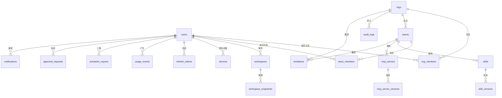

#### 6.8.2 表目录（关键字段）

主键统一用 UUIDv7（PostgreSQL 18 内置 `uuidv7()`，时间有序、索引友好）；`usage_events` 例外用 `bigserial`（分区表需包含分区键）。`schema_versions` 由 DDL 脚本维护（见 6.8.3）。

**账号与认证**

| 表 | 关键字段 |
| --- | --- |
| `users` | `id uuid PK, email citext UNIQUE, password_hash（SSO 用户可空）, display_name, avatar_url, locale(zh-CN\|en-US), is_system_admin, status(active\|disabled), email_verified_at, roles_version int, created_at, updated_at` |
| `devices` | `id, user_id FK, device_id text, platform(win32\|darwin), app_version, name, last_seen_at`，UNIQUE `(user_id, device_id)` |
| `refresh_tokens` | `id, user_id, device_id, token_hash UNIQUE, family_id, expires_at, revoked_at, replaced_by_id` |
| `identity_providers` | `id, name, type(oidc), issuer_url, client_id, client_secret_enc, scopes, enabled, allowed_email_domains text[], auto_join_org_id NULL, created_by, created_at` |
| `user_identities` | `id, user_id, provider_id, subject, email, last_login_at`；UNIQUE `(provider_id, subject)` |

**组织与团队**

| 表 | 关键字段 |
| --- | --- |
| `orgs` | `id, name, slug citext UNIQUE, description, status(active\|frozen\|deleted), created_by, created_at` |
| `org_members` | `id, org_id, user_id, role(admin\|member), status(active\|removed), joined_at`，UNIQUE `(org_id, user_id)` |
| `teams` | `id, org_id, name, description, status(active\|archived\|deleted), created_by`，UNIQUE `(org_id, name)` |
| `team_members` | `id, team_id, user_id, role(admin\|member), status, joined_at`，UNIQUE `(team_id, user_id)` |
| `invitations` | `id, type(org\|team), org_id, team_id, email, user_id, role, token_hash UNIQUE, status(pending\|accepted\|revoked\|expired), invited_by, expires_at, accepted_at` |
| `approval_requests` | `id, type, requester_id, org_id, team_id, target_type, target_id, payload jsonb, status, reviewer_id, review_comment, created_at, decided_at`；部分唯一索引：`(target_type, target_id) WHERE status='pending'` |

**市场资源**

| 表 | 关键字段 |
| --- | --- |
| `skills` | `id, org_id, team_id, name, slug, description, tags text[], status(draft\|published\|delisted\|deleted), status_revision bigint, latest_published_version_id, created_by, created_at, updated_at`；UNIQUE `(team_id, slug)`；GIN 索引 `tags`，`pg_trgm` 索引 `name/description` |
| `skill_versions` | `id, skill_id, version semver, digest sha256, object_key, size_bytes, file_count, manifest jsonb, changelog, status(pending\|published\|rejected\|superseded\|revoked), review_id, download_count, created_by, created_at`；UNIQUE `(skill_id, version)` |
| `mcp_servers` | `id, org_id, team_id, name, slug, description, tags, status, status_revision bigint, latest_published_version_id, created_by`；UNIQUE `(team_id, slug)` |
| `mcp_server_versions` | `id, mcp_server_id, version int, transport(stdio\|sse\|http), config_template jsonb, env_schema jsonb, docs_md, changelog, status(pending\|published\|rejected\|superseded\|revoked), review_id, created_by`；UNIQUE `(mcp_server_id, version)` |

**工作空间与快照**

| 表 | 关键字段 |
| --- | --- |
| `workspaces` | `id, user_id, team_id NULL, name, status(active\|archived), latest_snapshot_id, storage_bytes, created_at, updated_at` |
| `workspace_snapshots` | `id, workspace_id, version int, status(uploading\|active\|aborted), digest, manifest jsonb, size_bytes, file_count, device_id, comment, pinned bool, created_at`，UNIQUE `(workspace_id, version)` |

**用量与统计**

| 表 | 关键字段 |
| --- | --- |
| `usage_events` | `id bigserial, event_id uuid UNIQUE, user_id, org_id, team_id, workspace_id, device_id, session_id_hash, purpose(primary\|fast), provider, model, input_tokens, output_tokens, cache_read_tokens, cache_write_tokens, reasoning_tokens, requests, duration_ms, status, error_code, occurred_at, received_at, aggregated_at`；按月 `PARTITION BY RANGE (occurred_at)`，PK 包含分区键 |
| `usage_daily` | `day date, user_id, org_id, team_id, provider, model, input_tokens, output_tokens, cache_read_tokens, cache_write_tokens, requests, errors, estimated_cost numeric`；UNIQUE `(day, user_id, org_id, team_id, provider, model)` |
| `model_prices` | `provider, model, currency, input_per_1k, output_per_1k, cache_read_per_1k, cache_write_per_1k, effective_from`；PK `(provider, model, effective_from)` |
| `activation_reports` | `id, user_id, device_id, scope(global\|workspace), workspace_id NULL, resource_type(skill\|mcp), resource_source(market\|local), ref_id NULL, resource_key, name, version, enabled, reported_at`；UNIQUE (六元组 + `resource_key`，NULL 用 `NULLS NOT DISTINCT`)，写入模式：每次上报先删同设备同作用域旧行再插（事务） |

**平台**

| 表 | 关键字段 |
| --- | --- |
| `audit_logs` | `id bigserial, org_id NULL, actor_id, actor_ip inet, user_agent, action, target_type, target_id, detail jsonb, created_at`；索引 `(org_id, created_at DESC)`、`(actor_id, created_at DESC)` |
| `notifications` | `id, user_id, type, title, body, payload jsonb, read_at, created_at` |
| `system_settings` | `key PK, value jsonb, updated_by, updated_at`（配额、保留天数、最低客户端版本、邮件配置等） |

#### 6.8.3 Schema 管理（不引入迁移框架，D15）

目录结构：

```
db/
  ddl/V0001__init.sql
  ddl/V0002__usage_partitions.sql
  rollback/R0001__init.sql        # 重要变更必须提供回滚
  seed/dev_seed.sql               # 仅开发/测试
```

规则：

1. 已执行的脚本**只追加不改写**，任何修正用新编号表达。
2. 每个脚本末尾写入 `schema_versions(version PK, description, checksum, applied_at, applied_by)`，开头做幂等守卫（已应用则跳过）。
3. 执行方式：dev/test 由 CI 在部署前执行；生产由运维按发布单执行（预发先验证）。
4. 应用启动**不执行任何 DDL**；启动时校验 `schema_versions` 不低于代码期望版本，不匹配则 fail fast 拒绝启动。
5. 大表变更（如 `usage_events`）走在线 DDL 策略：先加可空列→回填→再加约束；索引用 `CONCURRENTLY`。

> 这是"无框架的迁移纪律"：保留可审查、可回滚的优点，代价是流程靠人工/CI 保证。命名与 Flyway 兼容，若未来需要自动化，可直接把 `db/ddl` 切为 Flyway 脚本，无需重写。

### 6.9 API 设计

#### 6.9.1 通用约定

- 前缀：`/api/v1`；响应统一 `application/json`（下载走预签名 URL）。
- 认证：`Authorization: Bearer <access_token>`；所有接口默认需登录，除注册/登录/重置密码/邀请预览。
- 错误：

```json
{ "code": "FORBIDDEN", "message": "需要团队管理员权限", "details": {}, "traceId": "..." }
```

错误码枚举：`UNAUTHENTICATED / REFRESH_REVOKED / FORBIDDEN / NOT_FOUND / CONFLICT / VERSION_CONFLICT / NAME_CONFLICT / VALIDATION_FAILED / PACKAGE_INVALID / QUOTA_EXCEEDED / RATE_LIMITED / ACCOUNT_DISABLED / CLIENT_TOO_OLD / METHOD_NOT_ALLOWED / INTERNAL`。

- 分页：`?page=1&pageSize=20`（≤100），响应 `{ "items": [], "total": 0, "page": 1, "pageSize": 20 }`。
- 幂等：写接口支持 `Idempotency-Key`（`/usage:batch` 必带）；快照完成接口由状态机保证幂等。
- 限流（Redis）：登录 10/min/IP；上报 30/min/设备；下载 60/min/用户；写接口 60/min/用户。超限返回 `RATE_LIMITED` + `Retry-After`。
- 版本协商：请求头 `X-Client-Version`，低于系统设置的最低版本时返回 `426 UpgradeRequired`（业务码 `CLIENT_TOO_OLD`）。

#### 6.9.2 端点清单

**认证与个人**

| 方法 | 路径 | 权限 | 说明 |
| --- | --- | --- | --- |
| POST | `/auth/register` | 公开 | 邮箱注册（验证邮件可关闭） |
| POST | `/auth/login` | 公开 | 本地账号密码登录，签发 access + refresh，记录设备 |
| GET | `/auth/providers` | 公开 | 可用登录方式（本地 + 已启用 SSO） |
| GET | `/auth/sso/{providerId}/authorize` | 公开 | 浏览器跳转 IdP（Authorization Code + PKCE，见 6.12） |
| GET | `/auth/sso/callback` | 公开 | IdP 回调：校验后签发一次性 code 并重定向 |
| POST | `/auth/sso/exchange` | 公开 | 一次性 code + PKCE verifier 换 token |
| POST | `/auth/refresh` | 公开（凭 refresh） | 旋转式刷新，重放检测 |
| POST | `/auth/logout` | 登录 | 按设备/全部注销 |
| POST | `/auth/password/forgot` `/reset` | 公开 | 重置密码 |
| GET/PATCH | `/me` | 登录 | 个人信息 |
| GET/DELETE | `/me/devices` `/{deviceId}` | 登录 | 设备管理 |
| GET/PATCH | `/me/notifications` | 登录 | 通知列表/已读 |
| POST | `/me/activations:report` | 登录 | 激活状态上报（见 5.10.3） |
| POST | `/usage:batch` | 登录 + 设备 | 用量批量上报 |

**组织**

| 方法 | 路径 | 权限 | 说明 |
| --- | --- | --- | --- |
| POST | `/orgs:apply` | 登录 | 申请创建组织 |
| GET | `/orgs` | 登录 | 我的组织 |
| GET/PATCH | `/orgs/{id}` | `org.manage` / 成员读 | 详情/修改 |
| GET | `/orgs/{id}/members` | 组织成员 | 列表（分页、搜索） |
| POST | `/orgs/{id}/invitations` | `org.member.invite` | 邀请入组织 |
| PATCH/DELETE | `/orgs/{id}/members/{userId}` | `org.member.invite` | 改角色/移除（保护最后管理员） |
| GET | `/orgs/{id}/teams` | 组织成员 | 团队列表 |

**团队**

| 方法 | 路径 | 权限 | 说明 |
| --- | --- | --- | --- |
| POST | `/teams:apply` | 组织成员 | 申请创建团队 |
| GET | `/teams/{id}` | 团队成员 | 详情 |
| GET | `/teams/{id}/members` | 团队成员 | 列表 |
| POST | `/teams/{id}/invitations` | `team.member.invite` | 邀请组织成员 |
| PATCH/DELETE | `/teams/{id}/members/{userId}` | `team.member.invite` | 改角色/移除 |

**审批**

| 方法 | 路径 | 权限 | 说明 |
| --- | --- | --- | --- |
| GET | `/approvals?scope=org\|team\|system&status=pending` | 对应审批人 | 待审列表 |
| GET | `/approvals/{id}` | 审批人或申请人 | 详情（含 payload） |
| POST | `/approvals/{id}:approve` | 对应审批人 | 通过（可带意见） |
| POST | `/approvals/{id}:reject` | 对应审批人 | 驳回（必填意见） |
| POST | `/approvals/{id}:cancel` | 申请人 | 撤回 |

**Skill / MCP 市场**

| 方法 | 路径 | 权限 | 说明 |
| --- | --- | --- | --- |
| POST | `/teams/{id}/skills` | `skill.submit` | 上传新 Skill（multipart，含 changelog） |
| POST | `/skills/{id}/versions` | `skill.submit` | 上传新版本 |
| GET | `/teams/{id}/skills?status=` | 团队成员 | 团队内资源（含待审） |
| GET | `/skills/{id}` | 团队成员/已下架后仅管理员 | 详情 + 版本列表 |
| POST | `/skills/{id}:delist` `:publish` | `skill.delist` | 下架/重新上架 |
| DELETE | `/skills/{id}` | `skill.delete` | 软删（保留对象按保留策略） |
| GET | `/skills/{id}/versions/{version}/download-url` | 团队成员 | 预签名下载（TTL 5min，计下载量） |
| GET | `/marketplace/skills?q=&tag=&orgId=&sort=` | 登录 | 我可见的已发布 Skill（跨团队） |
| POST/GET/PATCH/DELETE | `/teams/{id}/mcp-servers...` | 同 Skill 规则 | MCP 资源 CRUD + `:publish`/`:delist` |
| GET | `/marketplace/mcp-servers` | 登录 | MCP 列表 |
| POST | `/resources/status:check` | 登录 + 设备 | 批量查询已安装资源状态（≤ 100 条，见 5.12.3） |

**工作空间与同步**

| 方法 | 路径 | 权限 | 说明 |
| --- | --- | --- | --- |
| POST | `/workspaces` | `workspace.sync` | 关联本地工作空间 |
| GET | `/workspaces` | 本人 | 列表 + 用量 |
| POST | `/workspaces/{id}/snapshots:init` | owner | 乐观锁入口 |
| POST | `/snapshots/{id}:complete` | owner | 完成上传 |
| GET | `/workspaces/{id}/snapshots` | owner | 版本列表 |
| GET | `/snapshots/{id}/download-url` | owner | 预签名下载 |
| POST | `/snapshots/{id}:pin` | owner | 永久保留 |
| DELETE | `/snapshots/{id}` | owner | 删除非最新版本 |

**统计与审计**

| 方法 | 路径 | 权限 | 说明 |
| --- | --- | --- | --- |
| GET | `/stats/usage?scope=self\|team\|org\|global&from=&to=&groupBy=day\|model\|member\|team` | 按范围 | 用量聚合 |
| GET | `/stats/usage/export.csv?...` | 范围 + 导出权 | 流式导出（≤ 100 万行） |
| GET | `/stats/activations?type=skill\|mcp&teamId=&userId=` | 按范围 | 启用明细（用户×资源×版本） |
| GET | `/audit-logs?scope=org\|global&action=&from=&to=` | `audit.view` | 审计查询 |

**系统管理**

| 方法 | 路径 | 权限 | 说明 |
| --- | --- | --- | --- |
| GET | `/admin/orgs?status=` | `org.approve` | 组织列表（含待审批） |
| POST | `/admin/orgs/{id}:freeze` `:unfreeze` | `org.manage` | 冻结/解冻 |
| GET | `/admin/users?q=&status=` | `system.settings` | 用户检索、禁用 |
| GET/PUT | `/admin/settings` | `system.settings` | 配额/保留/最低版本 |
| GET/PUT | `/admin/model-prices` | `system.settings` | 价格表维护 |
| GET/POST/PATCH/DELETE | `/admin/identity-providers[/{id}]` | `system.settings` | SSO 身份源管理（client_secret 仅写入不回显） |

### 6.10 安全与审计

#### 6.10.1 认证安全

| 项 | 设计 |
| --- | --- |
| 密码存储 | argon2id（内存 64MB，迭代 3）；最小 10 位；常见弱口令内置小名单，生产通过 `HUAGENT_WEAK_PASSWORD_FILE` 挂载完整 top-10k 名单 |
| 登录防暴破 | 单账号 5 次失败后递增锁 1/5/15 分钟；IP + 账号双维度限流（登录 10/min/IP）。限流状态优先 Redis，不可用时降级为进程内存（本地/测试）；生产建议 `HUAGENT_RATE_LIMIT_STRICT=true`，Redis 不可用则直接拒绝登录 |
| refresh token | 仅存哈希；旋转式；重放检测触发该设备全家族会话撤销并写入站内通知（`security.refresh_replay`） |
| access token | 15 分钟；`roles_version` 不同步时强制刷新 |
| 登出 | 单设备/全部设备；管理员可强制某用户全下线 |
| 邀请 token | 仅存哈希，一次性，7 天有效，支持重发失效 |
| 敏感操作二次确认 | 删除组织/团队、强制下线、修改配额需重新输入密码（可配） |

#### 6.10.2 数据与存储安全

- 对象存储桶全部私有，仅通过预签名 URL 访问；上传 URL 限定 object key 与 Content-Length，下载 URL TTL 15 分钟且每次生成都鉴权。
- 静态加密：应用层不做内容加密（D4）；磁盘加密 / 对象存储 SSE 由部署方按需开启，应用层以私有桶 + 短时效预签名 URL + 审计作为约束。凭证类字段（如 IdP `client_secret`）例外，使用主密钥 AES-GCM 加密存储。
- 服务端不存储任何模型密钥、MCP 密钥、工作空间明文解析结果。
- 上传包服务端安全检查：zip 结构/路径/解压大小/压缩比（同 6.4.2）；预留 ClamAV 接入点（识别为病毒时拒绝并审计）。
- MCP URL 字段校验：仅允许 `http/https`；不允许 `file://`、`ftp://` 等；内网地址不做服务端限制（连接发生在客户端），但管理台展示风险提示。

#### 6.10.3 API 安全

- 全部输入用 Pydantic v2 模型校验；SQL 一律参数绑定（SQLAlchemy/psycopg 占位符，**禁止字符串拼 SQL**，排序字段/表名等走白名单枚举）；列表接口强制范围过滤。
- CORS：管理台同域部署（推荐）或白名单；Bearer 认证不使用 Cookie，无 CSRF 问题。
- 错误响应不泄露内部细节（堆栈只进日志，不进响应）。
- 登录/注册接口邀请人机验证预留（接入企业微信/短信可选）。

#### 6.10.4 审计覆盖

| 事件 | 关键字段 |
| --- | --- |
| 登录/登出/刷新失败 | `action=auth.login\|logout\|refresh_replay`，IP/UA |
| 组织/团队/成员变更 | `action=org.*\|team.*`，before/after |
| 审批决策 | `action=approval.approve\|reject`，含 payload 摘要与意见 |
| 资源发布/下架/删除 | `action=skill.publish\|delist\|delete` 等，含版本与 digest |
| 同步完成/删除快照 | `action=snapshot.complete\|delete`，含版本与大小 |
| 越权操作 | 组织管理员操作团队资源时 `detail.via_org_admin = true` |
| 系统设置与价格表变更 | `action=settings.update`，before/after |

审计日志只追加不修改；保留期默认 365 天（可配）；组织管理员只能看到本组织范围。

#### 6.10.5 数据生命周期

- 用户注销：账号 `disabled` 30 天后硬删 PII（邮箱、姓名）；`usage_daily` 保留但 `user_id` 置为匿名占位（保证历史统计不断）。
- 组织解散：资源软删，快照保留只读 90 天后删除（可配）；审计保留。
- 用量原始事件：90 天；`usage_daily`：24 个月；两者可配。
- 日志中禁止出现：token、密码、密钥、提示词/回复内容、文件路径（错误堆栈注意刷洗）。

**实现说明（v1.0）**

- **数据导出**：`GET /api/v1/me/export` 返回本人资料、成员关系、设备、身份绑定、通知、激活明细、
  用量日聚合、本人审计与保留策略说明（JSON，camelCase，便于人读）；导出动作写审计 `account.export`。
- **账号注销**：`POST /api/v1/me:delete`（需 `confirmEmail`，本地账号还需密码）→ 立即 `status='disabled'`、
  撤销该用户全部 refresh token、写审计 `account.delete_requested`；宽限期取
  `system_settings.account.deletion_grace_days`（默认 30 天）。
- **宽限期后清理**：worker 任务 `user.purge`（每日 04:00）对到点账号硬删 PII——
  邮箱改为 `deleted-<id>@deleted.invalid`、昵称固定为「已注销用户」、清空头像与密码哈希；
  删除设备、refresh token、身份绑定、通知、激活上报与个人工作空间（含对象存储快照对象）；
  `usage_events` 与 `usage_daily` 的 `user_id` 改挂匿名占位 `00000000-...-0000`，**历史统计不中断**。
  审计日志保留（行内已无 PII）。任务幂等，以 `users.purged_at` 标记避免重复处理。
- **保留策略**：`usage.retention_days`（原始事件 90 天，分区滚动删除）、
  `usage.daily_retention_days`（日聚合 730 天，worker `usage.daily.prune` 每日清理）、
  `snapshot.retention`（快照版本数）。三者在 `system_settings` 中可调。
- **宽限期内恢复**：不提供自助撤销（界面明确提示不可自助恢复）；运维可按 `operations.md`
  的 SQL 把账号置回 `active` 并清空 `deletion_requested_at`。阶段 B 的用户管理页面将提供该操作入口。
- **客户端入口**：个人中心 →「数据与隐私」提供导出（保存 JSON）与注销（二次确认）；
  注销成功后本地会话立即失效并回到登录门禁；**本地工作空间文件不随账号删除，界面提示用户自行清理**。

### 6.11 后台任务（worker）

| 任务 | 频率 | 幂等性设计 |
| --- | --- | --- |
| 用量聚合 → `usage_daily` | 每小时（+ 启动补偿一次） | 按小时桶标记 `aggregated_at`，可重跑 |
| 分区维护（建下月分区/删过期分区） | 每日 02:00 | 按存在性判断 |
| 快照清理（`uploading` 超时、超保留数、过期删除） | 每日 03:00 | 先删对象再删行，可重跑 |
| 邀请过期标记 | 每小时 | 幂等 UPDATE |
| 审批超时提醒（48h）/标记 stale（7d） | 每小时 | 状态位判断 |
| 邮件发送（邀请/审批结果，SMTP 可选） | 事件触发 + 重试 | `email_outbox` 状态机 |
| 审计/用量保留清理 | 每日 04:00 | 分区/范围删除 |

调度用 APScheduler（worker 进程内）+ PostgreSQL advisory lock 保证多实例下同一任务只执行一次；任务本身幂等（见上表），失败重试 3 次、记录 `job_runs` 并告警。v1 不引入消息队列，后续需要事件驱动再评估 RabbitMQ / Kafka。

---

### 6.12 SSO / OIDC 接入（D10 已确认：v1 支持）

#### 6.12.1 目标与边界

- 管理台与桌面客户端都支持企业 OIDC 登录（Authorization Code + PKCE）；本地邮箱密码登录保留作为应急兜底。
- v1 支持：多身份源、域名白名单、JIT 建号、自动加入指定组织（仅 `member` 角色）。
- v1 不做：IdP 组 → 组织/团队角色自动映射、SCIM 同步、SAML（后续按客户需求评估）。

#### 6.12.2 数据模型

- `identity_providers`：`issuer_url / client_id / client_secret_enc（服务端主密钥 AES-GCM 加密，主密钥来自环境变量 HUAGENT_MASTER_KEY）/ scopes / allowed_email_domains / auto_join_org_id / enabled`。
- `user_identities`：`(provider_id, subject)` 唯一，绑定本地 `user_id`；一个用户可绑定多个身份源。
- `client_secret` 写入后不可回显（管理台只显示“已配置”），修改仅支持覆盖。

#### 6.12.3 登录流程

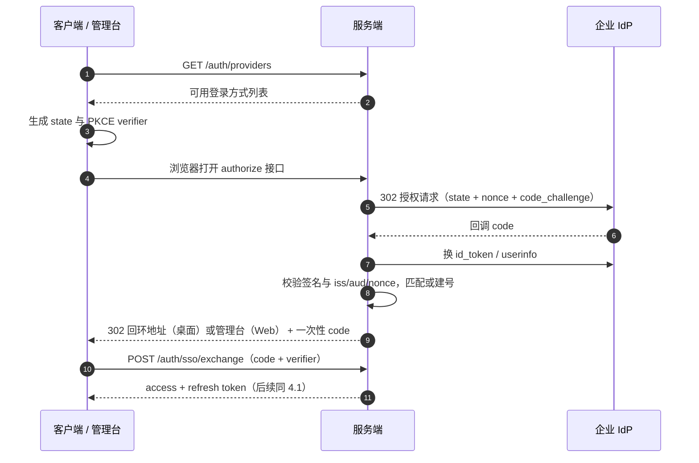

- 桌面端使用系统浏览器 + 回环重定向 `http://127.0.0.1:<随机端口>/callback`，`client_secret` 只存在服务端。
- 管理台（SPA）由服务端回调后携带一次性 code 重定向回应用，再走同一 `exchange`。
- 一次性 code 有效期 60s、单次使用；state / nonce / PKCE 全量校验；ID token 验签用 JWKS 缓存（1h，支持强制刷新）。

> 实现要点（阶段 7，详见 ADR 0005）：
> - 三方 PKCE：客户端对 `exchange` 持自己的 verifier；服务端持对 IdP 的 verifier（AES-GCM 加密存储）；
> - 一次性凭证存 PostgreSQL（`sso_login_requests` 10 分钟 / `sso_login_codes` 60 秒单次），不依赖 Redis；
> - `client_secret` 加密密钥来自 `HUAGENT_MASTER_KEY`（32 字节 Base64/hex），未配置时退化为从 jwt_secret 派生并告警；
> - 验签支持 HS256（无需额外依赖）与 RS256/ES256（JWKS 缓存 1h，需要 `cryptography`）。

#### 6.12.4 账号匹配与 JIT 供给

1. 先按 `(provider_id, subject)` 匹配，命中即登录并更新 `last_login_at`。
2. 未命中：要求 IdP 返回 `email_verified = true` 且邮箱域名在 `allowed_email_domains` 内，否则拒绝并提示联系管理员。
3. 邮箱已存在本地账号：默认绑定身份并登录（可配置为禁止自动绑定，更严格）；绑定写审计。
4. 新邮箱：创建用户（`password_hash` 为空）；若配置了 `auto_join_org_id`，以 `member` 角色加入（**任何情况下不自动授予管理员**）。
5. 全部 SSO 登录事件写审计（含 provider、subject、IP）。

#### 6.12.5 登出与禁用

- `POST /auth/logout` 撤销本地会话；若 IdP 提供 `end_session_endpoint` 且用户勾选“同时退出 IdP”，浏览器跳转 IdP 登出。
- 系统管理员可禁用身份源；禁用后新登录失败，且该身份源关联用户的 refresh token 立即全部撤销。

> 实现：`PATCH /admin/identity-providers/{id}` 置 `enabled=false` 或 `DELETE` 时，按 `user_identities` 找出关联用户，
> 一次性撤销其全部未撤销 refresh token（返回撤销条数）；禁用后 `/auth/sso/{id}/authorize` 返回 404。
> 个人设置提供 `GET /me/identities` 与 `DELETE /me/identities/{id}`，解绑前校验至少保留一种可用登录方式。
- 绑定关系可在个人设置中查看与解绑（解绑前需保留至少一种可用登录方式）。

---

## 7. hu-agent-management-ui 设计

### 7.1 技术要点

- React + TypeScript + Vite + Ant Design 5 + TanStack Query + React Router。
- 客户端从 OpenAPI 生成（`openapi-typescript` + 手写轻封装），禁止手写重复类型。
- 权限：登录后 `GET /me` 返回权限点与可见范围；路由与菜单按权限点渲染（**仅做展示控制，服务端仍强制鉴权**）。
- 布局：左侧导航（按当前角色动态）+ 顶部（当前组织/团队切换、待办审批铃铛、账号菜单）。
- 国际化：react-i18next 管理 zh-CN / en-US 文案；日期、数字、时区统一格式化；语言偏好存入用户设置。
- 列表页统一模式：筛选器 + 表格 + 分页 + 批量操作 + 导出；审批类页面统一"抽屉详情 + 通过/驳回"。

#### 7.1.1 v1.0 实现说明

- **类型来源**：`openapi-typescript` 生成 `src/api/schema.d.ts`（`npm run api:gen`，经 npx 临时运行，不写入依赖）；
  `npm run check` 校验 `schema.d.ts` 与 `openapi/openapi.json` 同源（`src/api/schema.hash`），避免接口变更后忘记重生成。
- **v1 不引入 TanStack Query**：改为自建 `useAsync`（加载态/错误/竞态保护/reload）。理由：页面数量有限、
  查询依赖简单，避免为 CRUD 场景新增运行时依赖；后续如出现复杂缓存需求再评估引入。
- **AntD 静态方法不可用**：antd v5 的 `message`/`notification`/`Modal.confirm` 静态调用在 React 19 下不渲染
  （实测：操作成功但无任何反馈）。统一改用 antd `<App>` 提供的上下文 API（`App.useApp()`），不使用静态调用。
- **令牌存放**：access token 仅内存；refresh token 存 `sessionStorage`（关闭标签页即失效，降低 XSS 影响面）；
  401 自动刷新一次，失败即回登录页。
- **错误文案**：服务端返回业务码，管理台按码本地化（`src/lib/errorText.ts`），未知码回退服务端原文并附 traceId 前缀。
- **语言**：顶部切换即写入 `users.locale`（PATCH /me），启动时按用户偏好设置界面语言；
  `node scripts/i18n-check.mjs` 在 `npm run check` 中强制（缺键或中英键不一致即失败）。
- **设备标识**：登录时以 `platform=web`、`deviceId=management-ui` 登记，便于在"设备与安全"中区分浏览器会话
  （服务端 `DeviceIn.platform` 枚举已含 `web`）。

#### 7.1.2 v1.0 交付范围（5-09 阶段 A）

已交付：登录（本地账号）、审批（列表/筛选/抽屉详情/通过/驳回/撤销自己的申请）、
Skill 管理与审核（列表/详情/SKILL.md 预览/版本列表/上架/下架/停用/启用/撤回版本/删除）、
成员与邀请（组织与团队两个维度、角色变更、移除、一次性邀请码）、身份源（SSO）管理（增删改查、启停、只写密钥）、
个人设置（昵称、语言、设备与安全、SSO 绑定、通知）。

阶段 B（已交付）：统计图表与导出、组织与团队治理、通知中心、审计日志、系统设置（配额/保留/宽限期/最低客户端版本）
与模型价格表、管理台自身 SSO 登录（浏览器端 PKCE）。

**阶段 B 实现说明**

- **组织与团队治理语义**：冻结组织（`orgs.status='frozen'`）与归档团队（`teams.status='archived'`）复用既有 RBAC
  `read_only` 语义：成员仍可见、可读，写操作被拒绝；解散组织（系统管理员）为软删——组织置 `deleted`、其团队归档、
  资源置 `deleted`，**个人工作空间与快照不受影响**（D12 个人所有），且不可自助恢复。
- **接口归属**：治理与运维接口集中在 `/api/v1/admin/*`（审计、设置、价格表、组织冻结/解冻/解散）与
  `PATCH /teams/{id}`（改名属团队管理员；状态变更属组织管理员或系统管理员），全部需系统管理员或相应管理员权限并写审计。
- **系统设置白名单**：仅暴露被服务端实际消费的键（`quota.*`、`snapshot.retention`、`usage.retention_days`、
  `usage.daily_retention_days`、`account.deletion_grace_days`、`min_client_version`），带类型与下限校验，
  避免 `system_settings` 变成任意键值仓库。
- **价格表**：`model_prices` 按 (provider, model, effective_from) 版本化，聚合时按调用当日生效价计费；
  管理台提供增删改查（每 1K token 单价，字段在 API 上命名为 `inputPrice` 等以避免 `1k` 别名歧义）。
- **审计查询**：`GET /admin/audit` 支持动作前缀/操作者/组织/目标类型/时间范围筛选与分页（仅系统管理员）。
- **管理台 SSO**：浏览器端 PKCE（S256），流程为 管理台 → 服务端 authorize → IdP → 服务端 callback →
  302 回管理台 `/sso/callback` → `/auth/sso/exchange` 换本地令牌；回跳地址必须为回环地址（开发）或登记在
  服务端 `cors_origins`（生产，见 deployment.md）。
- **尚未实现**（v1.x）：系统区的用户管理页面（用户列表/禁用/重置）、邀请撤销、统计页的成员维度下钻。


### 7.2 页面清单

| 区域 | 页面 | 可见角色 | 关键内容 |
| --- | --- | --- | --- |
| 公开 | 登录 / 注册 / 忘记密码 / 邀请接受 | 所有人 | 邀请接受页展示组织/团队名与邀请人 |
| 个人 | 我的申请与资源 / 我的用量 / 通知 / 设备与安全 / 语言设置 | 所有用户 | 提交记录、启用资源与状态、个人 token 曲线 |
| 组织 | 概览（成员数/团队数/存储/用量摘要） | 组织管理员起 | 卡片 + 趋势图 |
| 组织 | 团队管理（含待审批标签页） | 组织管理员 | 创建审批、冻结、成员 |
| 组织 | 成员与邀请 | 组织管理员 | 角色变更/移除（保护最后管理员） |
| 组织 | 统计（团队维度、成员维度、模型维度） | 组织管理员 | 筛选 + 导出 CSV |
| 团队 | 概览 | 团队成员 | 资源数与用量 |
| 团队 | Skill / MCP 管理（待审 / 已上架 / 已下架） | 团队管理员 | 审核抽屉（见 6.4.3）、上下架、删除 |
| 团队 | 成员与邀请 | 团队管理员 | — |
| 团队 | 统计（成员 × 资源激活 / 用量） | 团队管理员 | 启用明细表 + 用量图 |
| 团队 | 设置（关联工作空间配额提示） | 团队管理员 | — |
| 系统 | 组织审批 / 组织管理 / 全局统计 / 用户管理 / 审计日志 / 身份源（SSO）管理 / 系统设置（配额、保留、价格表、最低客户端版本） | 系统管理员 | 全局视图与导出 |

### 7.3 关键交互细节

- **待办徽标**：顶部铃铛轮询（30s）或 SSE 推送待审批数量，点击直达。
- **审核抽屉**：左侧文件树 + 中间 `SKILL.md` 预览（Markdown 消毒渲染）+ 右侧元数据/权限声明/diff 摘要 + 底部意见输入与操作按钮。
- **统计页**：默认时间范围"最近 30 天"；所有图表提供"导出 CSV"；空数据显式提示原因（如"无上报"）。
- **危险操作**：删除/冻结/强制下线二次确认弹窗需输入对象名称。
- **错误处理**：401 → 尝试 refresh → 失败跳登录；403 → 提示无权限并提供"申请权限"指引（联系管理员）。

---

## 8. 跨系统协议与兼容性

### 8.1 认证协议

- access token：JWT，HS256（单一部署）或 RS256（多服务，公钥可轮换）；claims：`sub, device_id, roles_version, exp, iat, jti`。
- refresh token：不透明随字符串，DB 存哈希；旋转 + 家族撤销。
- 客户端存储：refresh 入系统钥匙串；access 仅内存；登出清除全部。
- SSO：OIDC Authorization Code + PKCE（桌面端系统浏览器 + 回环回调），一次性 code 换 token；本地密码登录保留作为兜底，详见 6.12。

### 8.2 错误与重试约定

| 客户端行为 | 规则 |
| --- | --- |
| 网络超时 | 幂等 GET 重试 3 次；写接口不自动重试 |
| 401 | 单次 refresh 后重试；失败则登出 |
| 409 | 不重试，展示冲突选择流程 |
| 429 | 按 `Retry-After` 等待 |
| 5xx | 指数退避重试（上限 3 次），上报任务可长期重试 |

### 8.3 版本兼容

- 服务端 API 只做加法变更；废弃字段先标记 `deprecated`，至少跨 1 个小版本后移除。
- 客户端 `X-Client-Version` 上报；服务端 `system_settings.min_client_version` 强制升级（只对需要新协议的功能阻断，本地功能不受影响）。
- 包格式（`.hskill`）与 JSONL 均带 `v` 版本字段，升级时按版本迁移，不破坏旧文件。

## 9. 非功能设计

### 9.1 容量假设（设计基线）

| 指标 | 基线 | 扩展方式 |
| --- | --- | --- |
| 注册用户 | 10,000 | 无状态 api + 连接池 |
| 日活客户端 | 1,000 | — |
| 同时在线 API 请求 | 200 QPS 峰值 | api 水平扩展 + Redis 缓存 |
| 用量事件 | 100 万条/天（峰值 3 万/分钟） | 月分区 + 批量插入 + 小时聚合 |
| 快照上传 | 100 个/天，均 200 MB | 对象存储直传，不过 API 带宽 |
| 审计日志 | 50 万行/月 | 只追加 + 索引控制 |

### 9.2 性能预算

- API p95：普通读 ≤ 200ms，列表 ≤ 300ms，统计聚合 ≤ 800ms（超出走游标/预聚合）。
- 客户端：冷启动 ≤ 3s（不含模型首 token）；工作空间扫描 10 万文件 ≤ 10s（增量扫描）。
- 模型首 token：以模型服务为准，客户端不做额外缓冲；流式渲染 60fps 不卡顿（增量渲染节流 50ms）。

### 9.3 可靠性与备份

| 项 | 目标 |
| --- | --- |
| 服务可用性 | 99.9%（单机部署不承诺，需多副本 + 托管 PG/Redis） |
| RPO | ≤ 1h（PG WAL 归档 + 对象存储版本化） |
| RTO | ≤ 4h |
| 客户端离线 | 无模型时不可对话；本地模型则完全可用；上报排队不丢 |
| 数据一致性 | 快照/包对象先写后提交；事务内更新引用；reconcile 任务对账孤儿对象 |

### 9.4 可观测性

- 结构化日志（JSON）：`traceId, userId, route, latencyMs, status`；敏感字段白名单。
- 指标（Prometheus）：请求量/延迟/错误率、上报批次、聚合任务时长、快照上传字节、队列积压。
- 告警：5xx 比例 > 1%、队列积压 > 10k、聚合任务失败、磁盘/对象存储容量 > 80%。
- 客户端：本地日志滚动（10MB × 5），设置页可导出诊断包（自动脱敏：密钥、路径截断）。

### 9.5 兼容与分发

- 平台：Windows 10 1809+、macOS 12+（Apple Silicon / Intel）。
- 安装包：Windows NSIS + 签名（EV 证书）；macOS dmg + 公证（notarization）；均提供 sha256 校验。
- 自动更新：客户端启动检查版本 → 下载增量/全量包 → 校验签名 → 用户确认后重启安装；企业环境可配内部更新源。
- 语言：客户端与管理台支持 zh-CN / en-US；服务端错误返回业务码，通知与邮件按用户 `locale` 渲染。

---

## 10. 里程碑规划（建议）

| 阶段 | 交付物 | 验收标准 |
| --- | --- | --- |
| M0 设计冻结与技术验证 | 本文档基线；接口 schema（OpenAPI 骨架）；`db/ddl` 初版脚本；Python 3.14 依赖兼容性验证 | 11 章决策全部关闭；FastAPI / SQLAlchemy / psycopg 兼容性结论明确 |
| M1 Agent MVP | 客户端：Agent Loop + 6 个内置工具 + 会话 JSONL + 模型配置；服务端：账号/登录 | 本地无网环境下完成一次编码任务；会话可恢复 |
| M2 Workspace 与安全 | 沙箱、权限引擎、授权卡片、审计；工作空间管理、会话索引/搜索 | 越界访问 100% 弹窗；保护文件不可写；崩溃后会话可恢复 |
| M3 协作与市场 | 组织/团队/RBAC/审批；Skill 市场（上传-审批-下载-启用）；MCP 市场 | 端到端跑通：上传→审批→成员安装启用；越权用例测试通过 |
| M4 同步与统计 | 快照上传/下载/冲突处理；用量上报 + 聚合 + 统计页；管理台完整 | 换机器恢复工作空间；统计与本地记账对账误差 < 1% |
| M5 加固与发布 | 安全测试、压测、包签名、自动更新、审计导出；运维手册 | 安全清单全绿；1k 并发压测达标；发布流程演练通过 |

依赖关系：M2 必须在 M3 前（权限是市场安全的前提）；M4 的统计依赖 M1 的记账埋点。

## 11. 决策记录

**v1.0 已冻结**：全部决策已确认，接口与数据模型作为实现基线；后续变更需走设计变更并同步更新受影响章节。v1.1 调整 PostgreSQL 18 / DDL 脚本；v1.2（后端技术栈调整）D2 改为 Python 3.14 + FastAPI + uv，D15 数据访问改为 SQLAlchemy 2.0 + psycopg 3。

| 编号 | 决策点 | 结论 | 状态 |
| --- | --- | --- | --- |
| D1 | 客户端技术栈 | Electron + TypeScript | ✅ 已确认 |
| D2 | 服务端技术栈 | Python 3.14 + FastAPI + uv（ASGI：uvicorn） | ✅ 已确认（v1.2 调整） |
| D3 | 同步冲突策略 | 乐观锁 + 人工选择，不做自动合并 | ✅ 按推荐 |
| D4 | 快照加密 | 不加密：仅 TLS，依赖部署方静态加密 | ✅ 已确认 |
| D5 | 同步方式与会话纳入范围 | 手动 + 定时；会话随快照同步（默认包含，可排除） | ✅ 已确认 |
| D6 | Shell 默认授权策略 | Balanced（本会话首次询问） | ✅ 已确认 |
| D7 | OS 级沙箱 | 后续版本，v1 不做 | ✅ 按推荐 |
| D8 | Skill 包签名 | sha256 + 服务端元数据，预留企业签名 | ✅ 按推荐 |
| D9 | 资源共享范围 | v1 团队内，后续组织级共享 | ✅ 按推荐 |
| D10 | SSO / OIDC | v1 支持（OIDC Authorization Code + PKCE，见 6.12） | ✅ 已确认 |
| D11 | 企业策略下发（模型白名单/权限策略/禁用本地 Skill） | 后续版本，字段预留 | ✅ 按推荐 |
| D12 | 工作空间归属 | 个人所有（可关联团队） | ✅ 已确认 |
| D13 | 语言 | 客户端与管理台支持中文 + 英文（zh-CN / en-US） | ✅ 已确认 |
| D14 | 离线时资源状态强管控 | 默认不启用（沿用最后已知状态）；企业可选 `enforcement.maxStalenessHours` | ✅ 按推荐（讨论新增） |
| D15 | 数据库与数据访问 | PostgreSQL 18 + SQLAlchemy 2.0（psycopg 3）；schema 用编号 DDL 脚本手工维护，不引入 Alembic/Flyway | ✅ 已确认（v1.2 调整） |

### 11.1 v1.0 基线的关键补充

- **多会话**：一个工作空间可包含多个会话并可切换；同一时刻只有一个会话运行（5.3.3）。
- **资源双作用域**：Skill 与 MCP 均可在 Global 与当前 Workspace 两个作用域独立启用，Workspace 优先（5.7.2、5.8.1）。
- **资源下架感知**：客户端批量查询资源状态，分级处理（下架 = 软、停用/撤回/删除 = 硬），服务端定向通知 + 审计（5.12、6.4.5）。
- **SSO**：企业 IdP 登录与本地账号密码登录并存，本地密码保留为兜底（6.12）。
- **国际化**：客户端与管理台双语；服务端错误用业务码，端上本地化（5.13、9.5）。

### 11.2 已确认决策的落地位置

| 决策 | 影响章节 |
| --- | --- |
| D1 Electron | 3.2；5.1-5.13 |
| D2 Python + FastAPI | 3.2；6.1；6.11；6.9（FastAPI 自动 OpenAPI） |
| D15 SQLAlchemy / DDL | 3.2；6.1；6.8.3；6.10.3 |
| D3 / D4 / D5 | 5.11（同步全流程）、5.11.5、5.11.6 |
| D6 Balanced | 5.5.3、5.5.6 |
| D12 个人所有 | 6.6.1 |
| D10 SSO | 4.1、6.9.2、6.12、7.2 |
| D13 双语 | 5.13、7.1、9.5 |
| D14 离线管控 | 5.12.5 |

---

## 12. 附录

### 12.1 本地配置文件汇总

| 文件 | 作用域 | 进同步 | 可被 Agent 修改 |
| --- | --- | :-: | :-: |
| `~/.hu-agent/config.json` | Global | — | 否 |
| `~/.hu-agent/mcp.json` | Global | — | 否（UI 管理） |
| `~/.hu-agent/skills.json` / `installed.json` | Global | — | 否 |
| `<ws>/.hu/workspace.json` | Workspace | 是 | 否 |
| `<ws>/.hu/settings.json` | Workspace | 是 | 否 |
| `<ws>/.hu/skills.json` / `mcp.json` | Workspace | 是 | 否 |
| `<ws>/.hu/sessions/*` | Workspace | 是（D5） | 通过工具间接写入（仅会话文件） |
| `<ws>/.hu/logs/*` | Workspace | 否 | 否 |
| `<ws>/.hu/sync/*` | Workspace | 否 | 否 |

### 12.2 服务端对象存储布局

```
skills/{orgId}/{teamId}/{skillId}/{version}/{sha256}.hskill
mcp/                    # 无包，仅 DB 元数据
snapshots/{workspaceId}/{version}/{sha256}.zip
```

- 对象 key 不可预测（含 id 与 digest），桶私有，无目录列举权限。
- 不进回收站：删除采用"先标记录 deleted → 延迟 7 天 → worker 删对象"，防误删。

### 12.3 客户端与服务端错误码对齐

| 业务场景 | HTTP | code |
| --- | --- | --- |
| access token 过期 | 401 | `UNAUTHENTICATED` |
| refresh 重放或已撤销 | 401 | `REFRESH_REVOKED` |
| 权限不足 | 403 | `FORBIDDEN` |
| 乐观锁冲突 | 409 | `VERSION_CONFLICT` |
| 资源重名 | 409 | `NAME_CONFLICT` |
| 包校验失败 | 422 | `PACKAGE_INVALID` |
| 配额超限 | 402 | `QUOTA_EXCEEDED` |
| 客户端太旧 | 426 | `CLIENT_TOO_OLD` |
| 频控 | 429 | `RATE_LIMITED` |

### 12.4 开放问题（需产品/运维拍板）

1. 部署形态：企业内网自部署 / 公有云 SaaS / 两者都要？影响登录方式（SSO 必要性）与数据合规。
2. 邮箱服务：是否有可用的 SMTP 或企业邮箱 API？没有则邀请改为"邀请码"流程。
3. 是否有已有的账号体系（企业微信/钉钉/LDAP）需要对接？
4. 模型采购方式：统一下发 key（需服务端代理方案，与本文的"客户端直连"不同）还是客户端各自配置？
5. 是否需要支持组织级 Skill（不止团队级）？影响 `org` 级资源字段预留。

### 12.5 参考规范

- Model Context Protocol：https://modelcontextprotocol.io
- Agent Skills 格式（SKILL.md + 渐进披露思路）：https://docs.claude.com/en/docs/agents-and-tools/agent-skills
- JSON Schema / OpenAPI 3.1
- PostgreSQL 18：分区表、`NULLS NOT DISTINCT`、内置 `uuidv7()`

