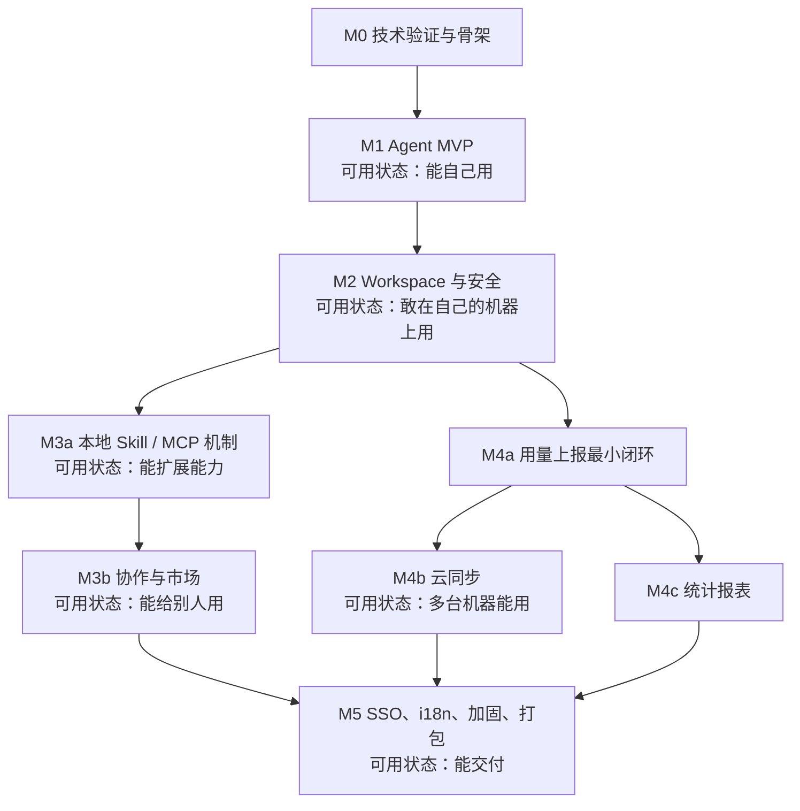

# hu-agent 执行计划（单人开发版）

- 文档版本：v0.3（重写：单人开发 + 企业交付语境）
- 日期：2025-10-13
- 关联文档：`design.md` v1.1（设计基线，D1-D15 已确认）
- 开发资源：1 名开发（全栈，同时承担产品/测试/运维职责）
- 交付对象：企业使用（安全、审计、SSO、签名分发等要求按 design.md 全量执行）
- 排期说明：不预先排期；阶段完成后用实际速率估算后续（单人估算误差大）

---

## 1. 计划说明

### 1.1 这份计划解决什么

单人开发的真正约束是**时间带宽**和**没有第二双眼睛**。因此本计划：

- 不排期：没有周数、迭代、甘特图、人员分工；
- 明确三个问题：**先做什么、做完什么算过、资源不足时先延后什么**；
- 每个阶段结束都留下**一个可运行、可演示的版本**，让进度可验证、可持续；
- 企业交付必需项（权限/审计/安全/SSO/签名/文档）不在"可以不做"之列，只调整先后顺序。

### 1.2 工作方式（单人约定）

1. **一次只推一个里程碑**，不在 M1 期间修 M4 的代码（记到待办即可）。
2. **风险先行**：不确定的技术（Python 3.14 依赖生态、模型适配、打包签名）在对应的第一个里程碑就验证掉。
3. **垂直切片**：每个里程碑都尽量做成"端到端可用的一小条"，而不是"各层只做一半"。
4. **完成即提交**：每个任务完成后立刻提交并写一句 changelog；永远保持 `main` 可构建。
5. **检查点而非排期**：每个里程碑末尾给"可运行版本 + 自测清单 + 是否 dogfood"三项动作，做完就进入下一阶段。
6. **延后而非放弃**：标 ⏳ 的任务可延后且不阻塞后续，但企业交付必需项必须在发布前补齐（见第 3 章）。

### 1.3 与 design.md 的关系

- `design.md` 是需求与设计基线，冻结不改的只有接口契约、DDL、安全机制这三类；其它实现细节可以边做边调整，调整后回写 design.md。
- 本计划只描述"做的顺序与完成标准"，具体字段、接口、文件格式一律以 design.md 为准（任务表中给出参考章节）。

---

## 2. 总体路线

### 2.1 里程碑依赖与每个阶段的"可用状态"



里程碑顺序的理由：

| 顺序 | 理由 |
| --- | --- |
| M0 最先 | 技术栈（Python 3.14 / FastAPI / PG18 / Electron）需要最早验证，避免白写 |
| M1 第二 | Agent Loop 是产品核心价值，先让自己每天用起来，才有动力继续 |
| M2 第三 | 真实文件上做沙箱与权限，安全是"敢用"的前提；也是后续市场安全的基础 |
| M3a 早于 M3b | 先把本地 Skill/MCP 机制做通（不依赖服务端），再上市场；MCP 可只做本地配置 |
| M4a 早于 M4b/c | 上报链路最小闭环早做，统计与同步都不再返工埋点 |
| M5 最后 | SSO、双语、签名、压测都属于"交付前"的打磨，早做会被返工 |

### 2.2 单仓库布局（已确认）

采用 monorepo（已确认），一次提交可以同时改客户端、服务端、管理台与契约：

```
hu-agent/                      # 一个仓库
  docs/
    design.md                  # 设计文档
    plan.md                    # 本文件
  app/                         # Electron 客户端（Node + TS）
  management/                  # Python 3.14 服务端（FastAPI + uv）
  management-ui/               # 管理台（Vite + React + AntD）
  db/ddl/                      # 编号 DDL 脚本 + rollback
  openapi/openapi.yaml         # 契约产物（CI 校验与代码生成源）
  scripts/                     # 本地脚本：起依赖、生成客户端、打包
```

> 分仓亦可行，但单人维护成本更高；当前按单仓执行。

### 2.3 检查点节奏（不是排期）

每个里程碑结束做三件事：

1. **可运行版本**：明确到"哪个命令/哪个安装包能跑起来"；
2. **自测清单**：把该里程碑的完成标准逐条手工过一遍（附录 B 模板）；
3. **dogfood**：用这个版本做一件真实的事（写代码、整理文件、跑脚本皆可），记录 3 个最烦人的问题作为下一阶段输入。

任务状态跟踪就用 GitHub Issues / 本地 TODO 文件，状态只有：`待办 / 进行中 / 完成 / ⏳ 延后`，不需要看板与燃尽图。

---

## 3. 范围守门与延后顺序

### 3.1 企业交付的底线（不可省略）

以下能力是 design.md 的企业级要求，无论资源多紧都不能省略，只能调整实现顺序与简化程度：

| 底线能力 | 最小实现 | 不可省略的原因 |
| --- | --- | --- |
| Agent Loop + 6 工具 + 会话 JSONL | 按设计 | 产品核心价值 |
| 工作空间沙箱 + 权限引擎 + 审计 | 决策矩阵可先粗后细，但审计必须落盘 | 企业安全底线 |
| 本地 Skill / MCP 机制 | 可先只支持本地目录，不上市场 | 扩展能力 |
| 模型配置 + 用量上报 | 可先只存本地，字段与接口按设计保留 | 企业统计与成本治理 |
| 分发与文档 | 签名安装包、部署与使用文档 | 交付物的一部分 |
| SSO | 按 D10 属于 v1，可最后做，但不能不做 | 企业账号体系要求 |

原则：**先让单机版在企业内可用（阶段 1-3），再补协作与治理（阶段 4-7）**；凡涉及“发布前必须补齐”的项，需报给需求方确认是否可延后到 v1.x。

### 3.2 资源不足时的延后顺序（不是删除）

| 顺序 | 延后项 | 影响 | 补齐时机 |
| --- | --- | --- | --- |
| 1 | ⏳ 管理台（先用 `.http`/curl 脚本管数据） | 管理不便，功能不受影响 | 发布前补齐管理入口 |
| 2 | ⏳ 英文 i18n（先中文，结构预留） | 英文体验缺失 | 发布前按 D13 补齐 |
| 3 | ⏳ 统计图表（先保留原始事件表 + 导出脚本） | 看不到图，数据不丢 | 发布前 |
| 4 | ⏳ 定时同步（先只手动） | 多机体验下降 | 发布前（D5 已确认） |
| 5 | ⏳ MCP 市场（先本地 MCP 配置） | 分发不便 | v1.x（需需求方确认） |
| 6 | ⏳ 云同步（先纯本地工作空间） | 换机靠手工拷贝 | v1.x（需需求方确认） |
| 7 | ⏳ Skill 市场与组织/团队/审批 | 无法多人协作 | v1.x（需需求方确认） |

### 3.3 单人开发的验证纪律（替代代码评审）

没有第二个人审代码，所以用流程与工具替代：

- 关键纯逻辑必须有单测：权限引擎、JSONL、同步清单、状态机、包校验；
- 提交前跑 `scripts/check-all`（lint + typecheck + 单测 + 构建），绿了才提交；
- 静态检查与依赖扫描进 CI（服务端 SpotBugs/依赖检查、客户端 eslint 安全规则与 npm audit）；
- 关键变更写 ADR（`docs/adr/NNNN-*.md`），记录“为什么这么选”，便于回溯（也是企业评审材料）；
- 阶段 5 前请公司安全/架构同事至少做一次设计或代码走查（外部视角）。

---

## 4. 分阶段任务清单

### 4.0 阶段与 design.md 里程碑对照

| 本计划阶段 | design.md 里程碑 | 性质 | 可用状态 |
| --- | --- | --- | --- |
| 阶段 0 | M0 | 三端骨架 | 技术可行 |
| 阶段 1 | M1（客户端部分） | 本地 Agent | 能自己用 |
| 阶段 2 | M2 | 沙箱与权限 | 敢用 |
| 阶段 3 | M3（客户端本地部分） | Skill / MCP 机制 | 能扩展 |
| 阶段 4 | M1（服务端）+ M4a | 账号 + 记账 | 有身份、有数据 |
| 阶段 5 | M3 | 协作与市场 | 能给别人用 |
| 阶段 6 | M4 | 同步与统计 | 多机、可观测 |
| 阶段 7 | M5 | 打磨与交付 | 能交付 |

任务表说明：`⏳` = 可延后（不阻塞后续阶段）；「完成标准」是自测时逐条打勾的依据；「设计参考」指向 design.md 章节。

### 4.1 阶段 0：技术验证与三端骨架（对应 M0）

| ID | 任务 | 前置 | 完成标准 | 设计参考 |
| --- | --- | --- | --- | --- |
| 0-01 | Python 3.14 / FastAPI / SQLAlchemy / psycopg 兼容性验证 | — | `uv sync` 生成并提交 `uv.lock`；hello API 跑通；SQLAlchemy 查写跑通；OpenAPI spec 可导出；pytest + Testcontainers PG18 能跑；结论（含不可能的替代库）写入文档 | 3.2、6.1 |
| 0-02 | 服务端包骨架（src/huagent 分包） | 0-01 | `management/` 可用 `uv run huagent-api` 启动，统一错误码 + traceId + 健康检查就绪；一个真实接口返回正确错误格式 | 6.1、6.9.1 |
| 0-03 | DDL 基线 + 执行脚本 + 启动校验 | 0-01 | `db/ddl/V0001__init.sql` 在干净 PG18 上执行成功；重复执行幂等；脚本写入 `schema_versions`；应用启动校验版本不匹配时拒绝启动 | 6.8 |
| 0-04 | OpenAPI 生成与 TS 客户端脚本 | 0-02 | 一条命令生成 `openapi/openapi.yaml` 与 TS 类型；生成物可编译；CI 能检测 spec 与代码不一致 | 6.9 |
| 0-05 | Electron 骨架与打包脚本 | — | `npm run dev` 能开窗；`contextIsolation` 开启；类型化 IPC 跑通一个例子（如取版本号）；`npm run dist` 能出 Windows 安装包（macOS 可选） | 5.1 |
| 0-06 | 本地依赖 docker-compose | — | 一条命令起 PG18 / Redis / MinIO / Keycloak / MailHog；文档里写清端口与账号 | 3.3 |
| 0-07 | 最小 CI | 0-02、0-05 | GitHub Actions 对 app / management / management-ui 各自跑 lint + 单测 + 构建；绿线为准 | 7.1（原计划） |
| 0-08 | ⏳ 管理台骨架 | 0-04 | Vite + AntD 能跑，接一个真实接口（如 `/auth/providers`），i18n 骨架就位 | 7.1、7.2 |
| 0-09 | 契约与 DDL 自审清单 | 0-03、0-04 | 用附录 A 的清单过一遍初版表结构与接口，发现问题就地改 | 6.8、6.9 |

**阶段退出**：能画出环境启动图 → 打开 Electron 窗口 → 调通一条从服务端到客户端的真实接口 → CI 绿。

### 4.2 阶段 1：Agent MVP（对应 M1 客户端部分）

目标：你能用它完成一件真实的事，即使还没联网、还没沙箱。

| ID | 任务 | 前置 | 完成标准 | 设计参考 |
| --- | --- | --- | --- | --- |
| 1-01 | 模型网关（OpenAI 兼容 + Ollama） | 0-05 | 流式对话跑通；错误分类（网络/限流/参数）与重试；密钥从系统钥匙串读写；能力声明（tools/contextWindow）可配置 | 5.9 |
| 1-02 | Agent Loop | 1-01 | 多轮工具调用循环跑通；可取消；max_steps 生效；事件流（文本/tool_use/tool_result/错误）收到 UI | 5.2 |
| 1-03 | 会话 JSONL 持久化与恢复 | 1-02 | 每轮追加 JSONL；重启后可列表/恢复/继续；崩溃后尾部非法行能容错；大输出落 artifact | 5.3 |
| 1-04 | 内置工具 + 注册表 | 1-02 | read/write/edit/bash 可用（PowerShell/ask_guide 可后补）；每工具单测；输出截断与错误封装正确 | 5.4 |
| 1-05 | 最小聊天 UI | 1-02 | 流式渲染、工具调用卡片、取消按钮、会话列表、模型设置页；Markdown 消毒 | 5.2.1 |
| 1-06 | 本地用量记账 | 1-03 | 每次调用写本地队列（含 token/模型/耗时/状态）；设置页能看到本地统计；崩溃不丢记录 | 5.10 |
| 1-07 | Anthropic 适配（⏳） | 1-01 | 同一个网关接口下可切换 provider；录制回放用例通过 | 5.9 |

**阶段退出（可 dogfood）**：断网、用本地模型或已配密钥，让 Agent 完成一件真实任务（改一个脚本/整理一个目录），完成后重启能恢复会话。

### 4.3 阶段 2：Workspace 与安全（对应 M2）

目标：敢把真实工作目录交给它。

| ID | 任务 | 前置 | 完成标准 | 设计参考 |
| --- | --- | --- | --- | --- |
| 2-01 | 工作空间管理 | 1-02 | 选目录初始化 `.hu`；多工作空间可切换；拖拽上传文件进入上传目录；工作空间信息可在 UI 看到 | 5.6 |
| 2-02 | 权限引擎与路径沙箱 | 2-01 | 决策矩阵生效（工作空间内允许、外部询问、敏感拒绝）；`realpath` 防逃逸；符号链接与 Windows 保留名/短名用例通过 | 5.5 |
| 2-03 | 授权卡片与审计 | 2-02 | 一次/本会话/始终 三种记忆生效；保护文件写入被拒并提示；`.hu/logs/audit.jsonl` 记录完整 | 5.5.4-5.5.7 |
| 2-04 | Shell 工具加固 | 1-04 | 超时/取消/输出截断/编码替换正确；Windows 下无 bash 时有清晰提示；子进程能彻底杀掉 | 5.4.2、5.2.5 |
| 2-05 | 会话增强 | 1-03 | 搜索可用；压缩阈值触发后摘要写入 JSONL；artifact 可按路径回读 | 5.2.3、5.3 |
| 2-06 | 平台兼容专测 | 2-02 | Windows / macOS 各跑一遍路径、编码、换行、权限用例；问题清单清零 | 5.5.4 |

**阶段退出**：故意在工作空间外取一个文件 → 弹窗授权 → 完成；故意让 Agent 改配置 → 被拒；能翻到对应审计记录。

### 4.4 阶段 3：本地 Skill / MCP 机制（对应 M3 客户端本地部分）

目标：不依赖服务端也能扩展能力；这一阶段做完，单机版已经很完整。

| ID | 任务 | 前置 | 完成标准 | 设计参考 |
| --- | --- | --- | --- | --- |
| 3-01 | Skill 本地机制 | 1-02 | 扫描 `~/.hu-agent/skills` 与 `<ws>/.hu/skills`；解析 `SKILL.md` front matter；Global/Workspace 双作用域启停与优先级正确；元数据注入系统提示、按需读取正文 | 5.7.1-5.7.3 |
| 3-02 | Skill 信任提示与管理 | 3-01 | 首次启用提示声明权限（脚本/shell/网络）；未声明的能力不自动授权；可卸载与固定版本 | 5.7.5 |
| 3-03 | MCP 客户端（stdio） | 1-02 | 配置解析（含 `secret://` 钥匙串）；拉起子进程；`tools/list` 成功；异常/退避重连；空闲回收 | 5.8.1-5.8.2 |
| 3-04 | MCP 工具接入权限与 UI | 3-03 | 工具命名空间正确；逐工具授权（本会话记忆）；工具卡片与错误展示；停用后连接关闭 | 5.8.2、5.5.3 |
| 3-05 | ⏳ MCP HTTP/SSE 传输 | 3-03 | http/sse 配置可连接；与 stdio 行为一致 | 5.8.1 |

**阶段退出（可 dogfood）**：把一个自写的 Skill 放进目录并启用，Agent 能按它工作；接一个 MCP server（如文件/时间工具）并在会话里调用成功。

### 4.5 阶段 4：账号与用量上报（对应 M1 服务端 + M4a）

目标：服务端轨道起步；先把"身份 + 记账"最小闭环打通，为阶段 6 的统计打底。

| ID | 任务 | 前置 | 完成标准 | 设计参考 |
| --- | --- | --- | --- | --- |
| 4-01 | 账号域服务端 | 0-02、0-03 | 注册/登录/刷新/登出/设备接口可用；argon2id；旋转刷新与重放撤销；登录限流；单测覆盖关键分支 | 6.2、6.9.2、6.10.1 |
| 4-02 | 用量接收服务端 | 4-01 | `POST /usage:batch` 幂等写入分区表；归属校验（团队/工作空间不存在则置空）；非法数据拒绝策略正确 | 6.7.1 |
| 4-03 | 客户端登录与令牌管理 | 4-01 | 服务器地址 + 本地账号登录；refresh 入钥匙串；401 自动刷新一次；登出清理 | 4.1、8.1 |
| 4-04 | 客户端上报队列接入 | 1-06、4-02 | 本地队列批量上报；失败退避重试；未登录不入队；设置页可看待上报数与清空；隐私边界（不传提示词/路径）自检通过 | 5.10 |
| 4-05 | 设备管理（简化） | 4-03 | 服务端可看到设备列表；可吊销指定设备（刷新令牌失效） | 6.2.2 |

**阶段退出**：登录后本地产生的 token 记录能在服务端 `usage_events` 查到，且与本地记账对账一致（误差 < 1%）。

### 4.6 阶段 5：协作与市场（对应 M3）

目标：从"我自己用"变成"能给别人用"。建议先 Skill 后 MCP、先服务端后客户端、管理台最后。

| ID | 任务 | 前置 | 完成标准 | 设计参考 |
| --- | --- | --- | --- | --- |
| 5-01 | 组织 / 团队 / 成员 / 邀请 | 4-01 | 组织创建审批（自己审）；团队创建；邀请链接可用；最后管理员保护生效 | 6.2.1、6.3.2-6.3.4 |
| 5-02 | RBAC 与范围断言 | 5-01 | 权限点矩阵实现；列表接口强制范围过滤；越权返回 403 并写审计 | 6.2.2-6.2.3 |
| 5-03 | 通用审批流 + 通知 | 5-01 | 四种审批类型接入；状态机单调；站内通知可读；同一资源只能一个 pending | 6.3.1 |
| 5-04 | Skill 市场服务端 | 5-03 | 上传流式校验（zip 安全/大小/文件数/front matter）；审批→发布/驳回；下架/撤回/删除；预签名下载；pg_trgm 搜索 | 6.4 |
| 5-05 | Skill 客户端市场 | 5-04、3-01 | 浏览/详情/下载/安装/更新/启停（双作用域）；sha256 校验与安全解压；离线时已安装可用 | 5.7.4 |
| 5-06 | 资源状态同步服务端 | 5-04 | `/resources/status:check` 返回 active/delisted/disabled/revoked/not_found；status_revision 变更；停用必填原因；定向通知 | 6.4.5 |
| 5-07 | 资源状态同步客户端 | 5-06、3-01 | 启动/定时/启用前检查；软硬停用行为正确；恢复后按原意图启用；本地审计记录 | 5.12 |
| 5-08 | ⏳ MCP 市场（服务端 + 客户端） | 5-04、3-03 | 配置模板与 env_schema 展示；安装引导填密钥；审批/停用与 Skill 一致 | 6.5、5.8.3 |
| 5-09 | ⏳ 管理台（组织/团队/审批/资源） | 5-04 | 审批抽屉（SKILL.md 预览/权限声明/文件列表）可用；资源上下架操作可用；中英文无关（可用中文） | 7.2、7.3 |
| 5-10 | 管理台缺失时的临时代办路径 | 5-03 | 提供 `.http`/curl 脚本完成审批与上下架，文档写清步骤（5-09 延后时使用） | 附录 C |

**阶段退出**：在第二台机器（或第二个账号）上完整跑通：上传 → 审批 → 安装 → 启用 → 管理员停用 → 客户端感知并停用。

### 4.7 阶段 6：云同步与统计（对应 M4）

目标：多台机器可用；数据可查、可导出、可对账。

| ID | 任务 | 前置 | 完成标准 | 设计参考 |
| --- | --- | --- | --- | --- |
| 6-01 | 快照服务端 | 0-03、4-01 | `snapshots:init/complete` 乐观锁可用；预签名直传；sha256 校验；uploading 超时清理；配额生效 | 6.6 |
| 6-02 | 同步引擎客户端（手动） | 6-01、2-01 | 排除规则/清单/摘要正确；单飞锁；上传下载可断点重试（限单次）；冲突时阻塞并提供三个选项 | 5.11.1-5.11.4 |
| 6-03 | 同步 UI | 6-02 | 状态栏与进度；冲突选择界面；配额与版本列表可见 | 5.11.3 |
| 6-04 | ⏳ 定时同步 | 6-02 | 档位设置生效；脏检查不发无效请求；冲突即暂停；失败静默重试 | 5.11.5 |
| 6-05 | 用量聚合与价格表 | 4-02 | 小时 rollup 到 `usage_daily` 可重跑；`model_prices` 生效；错误事件计数正确 | 6.7.1-6.7.2 |
| 6-06 | 统计 API + 激活明细 | 6-05、3-01 | 个人/团队/组织/全局查询；激活上报（客户端）与服务端状态合并展示；范围权限正确 | 6.7.2、5.10.3 |
| 6-07 | ⏳ 统计页面 | 6-06 | 一个页面（管理台或客户端内）能看用量曲线与激活清单；CSV 导出可用 | 7.2 |
| 6-08 | 保留 / 清理 / 对账任务 | 6-01、6-05 | 过期分区删除；快照保留数与 pin；孤儿对象对账日志 | 6.11 |
| 6-09 | 换机恢复与对账验收 | 6-02、6-06 | 新机器登录后从最新快照恢复（含会话）；统计与本地记账误差 < 1%；配额/保留行为符合预期 | 5.11、6.6.3 |

**阶段退出**：第二台机器（或重装环境）能恢复工作空间并继续开发；统计页能解释"这个月的 token 花在哪"。

### 4.8 阶段 7：打磨与交付（对应 M5）

| ID | 任务 | 前置 | 完成标准 | 设计参考 |
| --- | --- | --- | --- | --- |
| 7-01 | ⏳ SSO（服务端 + 客户端 + 身份源页） | 4-01 | Keycloak 上验证授权码 + PKCE 全流程；JIT 建号与域名白名单生效；本地账号仍可应急登录 | 6.12 |
| 7-02 | ⏳ i18n（中 / 英） | 1-05、5-09 | 客户端与管理台可切换；无硬编码中文缺口；通知模板双语 | 5.13、7.1 |
| 7-03 | 安全用例补齐 | 5-04、5-02 | zip-slip/炸弹/超大包拒绝；RBAC 越权用例全通过；刷新令牌重放必触发撤销 | 6.10 |
| 7-04 | 性能与容量验证（轻量） | 6-01、6-05 | 上报峰值不丢不重；10 万文件快照可完成；API 慢查询已优化（看索引与执行计划） | 6.7、9.1 |
| 7-05 | ⏳ 打包签名 / 公证 | 0-05 | Windows 签名安装包；macOS 公证（若分发）；升级与回滚验证；未签名时的绕过步骤写入文档 | 9.5 |
| 7-06 | 文档与发布清单 | 全部 | 使用手册、部署说明、发布 checklist（附录 B）、变更记录；密钥与配置说明 | 1.2、7.5 |
| 7-07 | 全链路回归清单 | 全部 | 从安装 → 登录 → 会话 → 工具 → 工作空间 → Skill/MCP → 同步 → 统计 → 登出，手工走一遍无阻断 | — |

**阶段退出**：在一台干净机器上按文档完成安装→配置→使用→同步全流程，无需临时改代码。

---

## 5. 测试与质量（单人开发）

### 5.1 必做（每个阶段）

| 项 | 范围 | 方式 |
| --- | --- | --- |
| 纯逻辑单测 | 权限决策、路径沙箱、JSONL 读写、同步清单/摘要、审批状态机、zip 校验 | Vitest / pytest，跟着代码一起写 |
| API 冒烟 | 每个服务端阶段的核心接口 | HTTP 脚本（`.http`/curl），提交入库，改了就跑 |
| 安全用例 | 路径逃逸、符号链接、保护文件、zip 炸弹、越权、令牌重放 | 单测 + 脚本，阶段末必过 |
| 手工 UI 清单 | 会话、授权卡片、市场、同步冲突、设置 | 每个阶段退出时按附录 B 走一遍 |
| 平台兼容 | Windows / macOS 路径、shell、编码、换行 | 阶段 2 / 7 各手动过一遍 |
| 静态与依赖扫描 | 服务端静态分析与依赖漏洞；客户端 eslint 安全规则与 npm audit | 进 CI，主干每次跑 |

### 5.2 后置，但发布前必须补齐

| 项 | 补齐节点 | 最低要求 |
| --- | --- | --- |
| 发布冒烟 E2E | 阶段 7 | 至少 5 条：登录、会话+工具、授权、市场安装、同步恢复 |
| 监控与告警 | 阶段 6 起 | staging / prod 接 Prometheus + Grafana（或云监控），有基本告警规则 |
| 性能验证 | 阶段 7 | 上报峰值不丢不重；10 万文件快照可完成；慢查询有执行计划 |
| 覆盖率门槛 / 变异测试 | 不做 | 用“关键路径单测清单”替代，写进附录 A |

### 5.3 提交前必跑的"一键检查"

建议在仓库根放 `scripts/check-all.sh`：lint + typecheck + 单测 + 构建三端（能并行就并行）。习惯：**每次改完就跑，绿了再提交**；main 永远可构建。

---

## 6. 开发流程与打包（单人版）

### 6.1 日常脚本（放 `scripts/`）

| 脚本 | 作用 |
| --- | --- |
| `dev-deps` | 起 / 停 docker-compose 依赖 |
| `ddl-apply` | 按编号顺序执行未应用的 DDL（本地/测试库） |
| `gen-openapi` | 启动服务端 → 导出 spec → 生成 TS 客户端 |
| `check-all` | lint + 单测 + 构建 |
| `dist-app` | 打当前平台安装包（对外分发必须签名） |

### 6.2 版本与发布

- 版本号手动维护：客户端/服务端/管理台各自 semver；DDL 用 `V000N`。
- 发布 = 打 tag + 变更记录 + 签名安装包（企业分发必须签名）；CI 只做验证，分发本地/手动完成。
- 数据库变更：新编号脚本 + 回滚脚本 + 应用启动校验版本，三步齐全才提交。
- 关键选型与机制变更写 ADR（`docs/adr/`），阶段结束写简短 changelog，作为交付文档的一部分。

### 6.3 数据与密钥保护

- 代码、文档、DDL、脚本全部入仓库；工作空间与 `.hu` 不入库（加 `.gitignore`）。
- 模型密钥只存系统钥匙串；仓库里只有 `secret://` 引用。
- 定期备份：仓库远端 + 重要工作空间快照（正是本产品自己要解决的问题）。

---

## 7. 风险与对策（单人开发 + 企业交付）

| 风险 | 表现 | 对策 |
| --- | --- | --- |
| 单点依赖 | 只有一个人懂全部实现 | 文档与 ADR 持续更新；做到“换台电脑 clone + 文档就能继续” |
| 无代码评审 | 缺陷与安全漏洞自己看不见 | CI 门禁 + 关键路径单测 + 静态/依赖扫描；阶段 5 前请安全/架构同事走查一次 |
| 上下文切换 | 一人同时做客户端/服务端/UI/测试，进度慢 | 严格阶段顺序；每个阶段一个主线；延后项显式标记而不是并行 |
| 新栈踩坑 | Python 3.14 依赖 / Electron 生态卡住 | 阶段 0 spike 先行；卡住超半天换实现并记 ADR |
| 需求变更 | 需求方追加要求打乱节奏 | 变更走 design.md 流程，评估影响后更新本计划；不接受口头插入 |
| 模型 API 费用 | 开发期花费不可控 | 默认本地 Ollama；付费模型只做适配回归；用本产品自身的上报看花费 |
| 签名/公证 | 分发被 SmartScreen/公证卡住 | 尽早申请证书与 Apple 账号；本机调试可临时未签名，对外分发必须签名 |
| SSO 无真实 IdP | 无法验证企业登录 | 本地 Keycloak 先行；staging 接真实 IdP；未验证项明确标注 |
| 数据与合规 | 审计/保留/删除策略未落地 | 按 design.md 6.10.5 实现，阶段 7 自检并出具结论 |

---

## 8. 下一步（现在就可以做的三件事）

1. **建仓库与目录**：按 2.2 的 monorepo 布局建好，把 `design.md`、`plan.md` 移入 `docs/`，加 `.gitignore` 与 `README`。
2. **跑 0-06 + 0-01**：写 `scripts/dev-deps` 起 PG18/Redis/MinIO/Keycloak，然后做 Python spike（`uv sync` + FastAPI hello + SQLAlchemy 查写 + pytest/Testcontainers）。
3. **落 0-03 初稿**：把 `db/ddl/V0001__init.sql` 的核心表写出来（users/orgs/teams/…），本地执行一遍并在应用启动时校验 `schema_versions`。

三步完成后再开 0-05（Electron 骨架），阶段 0 就算有了雏形。

---

## 9. 附录

### A. 契约与 DDL 自审清单

- [ ] 每张表都有主键、创建/更新时间、外键索引；常用查询有索引（`(org_id, created_at DESC)` 类）
- [ ] 状态字段都有明确枚举与默认值；联表状态有“生效状态推导”说明
- [ ] 软删（deleted）与硬删策略明确；对象存储 key 不可预测
- [ ] `NULLS NOT DISTINCT` / 分区表 / `uuidv7()` 用法符合 PG18 语法
- [ ] API 路径、错误码（6.9.1）、分页、幂等键符合约定；无破坏性变更
- [ ] 权限点与角色矩阵逐项能对应到至少一个接口/断言

### B. 阶段退出自测模板

1. 按阶段退出标准逐条执行，记录命令/步骤/结果；
2. 截图或日志存到 `docs/verify/M<n>/`（便于客户/企业评审回看）；
3. 对本次全部代码 diff 做一次自我走查（重点：安全、错误处理、日志泄密）；
4. 列出 3 个最影响体验的问题（→ 下一阶段输入）；
5. 更新本计划：完成的打勾，延后的标 ⏳，新增任务补 ID。

### C. 无管理台时的临时代办路径

用 `.http` 文件跑审批与上下架（示例骨架）：

```http
### 登录拿 token
POST {{base}}/api/v1/auth/login
Content-Type: application/json

{ "email": "me@example.com", "password": "..." }

### 待办审批列表
GET {{base}}/api/v1/approvals?status=pending
Authorization: Bearer {{token}}

### 通过审批
POST {{base}}/api/v1/approvals/{{id}}:approve
Authorization: Bearer {{token}}
```

这些脚本同时是阶段 5 的接口冒烟用例，不会白写。

### D. 任务速查（可勾选）


**阶段 0**：0-01 0-02 0-03 0-04 0-05 0-06 0-07 0-08⏳ 0-09
**阶段 1**：1-01 1-02 1-03 1-04 1-05 1-06 1-07⏳
**阶段 2**：2-01 2-02 2-03 2-04 2-05 2-06
**阶段 3**：3-01 3-02 3-03 3-04 3-05⏳
**阶段 4**：4-01 4-02 4-03 4-04 4-05
**阶段 5**：5-01 5-02 5-03 5-04 5-05 5-06 5-07 5-08⏳ 5-09⏳ 5-10
**阶段 6**：6-01 6-02 6-03 6-04⏳ 6-05 6-06 6-07⏳ 6-08 6-09
**阶段 7**：7-01⏳ 7-02⏳ 7-03 7-04 7-05⏳ 7-06 7-07

（⏳ = 可延后，不阻塞后续阶段）

### E. 发布前必须补齐清单（企业交付）

按第 3 章的延后策略，以下项在发布到企业前必须全部完成；每项完成时在此打勾并记录证据位置：

**功能与体验**

- [ ] 管理台（组织/团队/审批/资源/统计）可完成全部管理操作，不依赖 `.http` 脚本
- [ ] 英文 i18n 无漏翻（D13），语言切换持久化
- [ ] 统计图表与 CSV 导出可用（含激活明细与服务端状态）
- [ ] 定时同步可用（D5），冲突处理路径完整
- [ ] SSO 在至少一个真实 IdP 上验证通过（6.12）

**安全与合规**

- [ ] 安全用例全结（路径逃逸/zip/越权/令牌重放）并留有报告
- [ ] 依赖扫描与静态扫描无高危未处理项
- [ ] 审计/保留/删除策略按 design.md 6.10.5 自检通过
- [ ] 保护文件、权限决策矩阵与产品说明一致

**交付物**

- [ ] Windows / macOS 签名安装包，升级与回滚验证通过
- [ ] 部署手册、使用手册、运维/回滚手册完成
- [ ] staging / prod 监控与告警可用，告警联系人与值班方式明确
- [ ] 发布冒烟 E2E 5 条全过；性能验证结论已出

**用户与需求方**

- [ ] 需求方验收演示完成（附录 B 模板）
- [ ] 遗留问题清单经需求方确认并记录到 v1.x 计划

